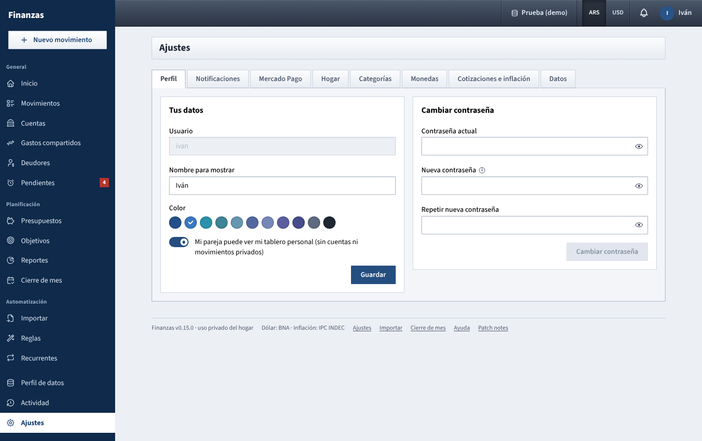

# Ajustes

Your own profile and password, email (and Telegram) alerts, the household's shared settings and people, categories, how amounts are shown, exchange rates and inflation, export and backups.

## What you see

Open it from the sidebar, the user menu or the footer. The page has eight tabs and opens on the first one (the address remembers the tab you're on, e.g. `/ajustes?tab=currencies`):

| Tab | What it holds | Applies to |
| --- | --- | --- |
| **Perfil** | Your name, color, dashboard sharing and password | You, in every data profile |
| **Notificaciones** | Your email for alerts, which alerts to receive, optional Telegram | You, in every data profile |
| **Mercado Pago** | Your own Mercado Pago connection (token, start date, what it can read) | You only, in every data profile |
| **Hogar** | Household name, default split, BNA quote, budget alerts, inflation indexing; the people | Settings: the data profile in use. People: every profile |
| **Categorías** | Expense and income categories | The data profile in use |
| **Monedas** | **Ocultar centavos** for ARS and USD | The data profile in use |
| **Cotizaciones e inflación** | BNA dollar quotes and INDEC CPI | The data profile in use |
| **Datos** | Export to CSV and Excel, backups | The data profile in use |

"Data profile" is explained in [Perfil de datos](perfil-de-datos.md).

## What you can do

### Perfil

**Tus datos**

- **Usuario**: shown greyed out; it can't be changed.
- **Nombre para mostrar**: how you appear in tabs, lists and reports.
- **Color**: pick a swatch. It's used for your initial in the top bar and for you in charts.
- **Mi pareja puede ver mi tablero personal (sin cuentas ni movimientos privados)**: on by default. When off, your name disappears from your partner's dashboard tabs, they see a **Tablero privado** label next to you under **Hogar → Personas**, and **Reportes → Por persona** hides your personal spending and income from them. Shared expenses still show for both of you.

Click **Guardar**; *Perfil actualizado* confirms it.

**Cambiar contraseña**

1. Type your **Contraseña actual**.
2. Type the **Nueva contraseña** (at least 10 characters) and repeat it in **Repetir nueva contraseña**.
3. Click **Cambiar contraseña**. The message *Contraseña cambiada. Se cerraron tus otras sesiones.* means every other browser where you were logged in now asks for the new password. This one stays logged in.

If something is wrong the field turns red: *La contraseña actual no es correcta.*, *Las contraseñas nuevas no coinciden.* or *La contraseña debe tener al menos 10 caracteres.*

### Notificaciones

Everything the app tells you lands in the bell in the top bar. This tab decides what is also sent to you by email (or Telegram).

**Correo** (with an **Activo**, **Falta configurar** or **Sin correo** label)

1. Type **Tu correo** and click **Guardar** (or press Enter). An invalid address is marked in red.
2. Once saved, the address shows as text. Click the pencil next to it to change it (**Cancelar** leaves it as it was).
3. Click **Enviar prueba** to check it arrives.

Sending is free with a Gmail account. **Falta configurar** means nobody has set up the account that sends the emails yet: the **Cuenta que envía los avisos** card next to it does that once for both of you. Step by step: [Set up email notifications](configurar-correo.md).

**Qué avisos recibir**: budgets, recurring items to confirm, and the monthly review (.docx attached). They apply to email and Telegram alike.

**Telegram (opcional)** (with a **Vinculado** or **Sin vincular** label)

If the card says **El bot no está configurado en el servidor**, whoever runs the server has to create a bot with @BotFather and give its token to the app, then restart it. The steps are listed on screen. Until then Telegram can't be used.

To link your Telegram:

1. Click **Vincular Telegram**. A code appears, for example `/start 3f9a2c71`.
2. In Telegram, open the household's bot and send it exactly that line.
3. Back in the app, click **Ya lo envié**. You'll see *Telegram vinculado*, and the bot answers *Listo, vas a recibir las alertas de Finanzas acá.*

- The code is valid for 15 minutes (and until the server restarts). Otherwise you get *Código vencido. Generá uno nuevo.*
- If you click **Ya lo envié** before sending the message: *Todavía no recibimos tu mensaje.* Send it and try again.
- Once linked, **Enviar prueba** sends a test message and **Volver a vincular** links a different chat.
- **Chat ID (manual)**: if you already know your chat ID you can type it and click **Guardar**. Emptying the field and saving unlinks Telegram.

Each of you links your own Telegram.

**Qué avisos recibir**

- **Presupuestos al 80% y superados**: budget alerts (at the two levels set in **Hogar**, 80% and 100% unless changed).
- **Recurrentes pendientes de confirmar**: a recurring item has become pending.
- **Cierre de mes (documento .docx)**: last month's review, sent in the first three days of each month.

Each switch saves as soon as you flip it. The notice that budgets were raised by inflation is always sent when Telegram is linked. If the server has its public address set, messages include a link to the right page.

### Mercado Pago

Connect your own Mercado Pago account with its production **Access Token**. It's checked with Mercado Pago, stored encrypted and never shown again; your partner can't see it. Step by step, and what each line means: [Connect Mercado Pago](mercado-pago.md).

### Hogar

**Hogar** card. Click **Guardar** at the bottom to apply (*Ajustes del hogar guardados*).

- **Nombre del hogar**: used as the title of the household's monthly .docx report. The dashboard tab is still called **Hogar**.
- **División por defecto de gastos compartidos**: used whenever a shared expense or income is saved with the default split.
  - **Partes iguales**: everyone pays the same.
  - **Porcentajes personalizados**: one box per person, for example 60% and 40% (proportional to income). **Suma** below turns green at exactly 100%; otherwise saving fails with *La división por defecto debe sumar 100%.*
  - Movements already saved keep their split amounts until someone edits them.
- **Cotización BNA para convertir**: which Banco Nación official quote converts between pesos and dollars everywhere in the app:
  - **Vendedor (lo que pagás al comprar dólares)**, the default;
  - **Comprador (lo que te pagan al vender)**;
  - **Promedio** of the two.
  Changing it recalculates all conversions at once, past ones included.
- **Primer aviso de presupuesto** and **Segundo aviso**: the percentages of a budget (1 to 200) at which you get an alert. Defaults: 80% and 100%. See [Presupuestos](presupuestos.md).
- **Ajustar presupuestos por inflación** (checkbox): shows every budget in pesos (household and personal) adjusted by the CPI published since it was set. Same setting as the checkbox on **Presupuestos**; it never compounds. Details in [How the numbers are worked out](como-se-calcula.md#budget-indexing).

**Personas** card

- One line per person: color, name, `@username`, and labels **Telegram** (linked) and **Tablero privado** (not sharing).
- **Agregar persona**: fill **Usuario**, **Nombre para mostrar** and **Contraseña inicial** (at least 10 characters; they can change it later in **Perfil**), then click **Agregar**. *Persona agregada. Ya puede ingresar con su usuario y contraseña.* Usernames follow the same rules as at first setup and must be unique.
- Up to four people. Any logged-in person can add one, and the new person exists in every data profile. People can't be removed or renamed from here; each person edits their own name.

If you use **Porcentajes personalizados** and add a person, the new person starts at 0%: review the split and save again.

### Categorías

- Choose **Gastos** or **Ingresos** at the top left. **Mostrar archivadas** also lists archived ones, faded.
- Each main category is a card with its subcategories inside. Only one level of subcategories exists.
- The three-dot menu next to each name offers **Editar**, **Agregar subcategoría** (main categories only), **Archivar** / **Desarchivar** and **Eliminar**.

To add one:

1. Click **Nueva categoría** (or **Agregar subcategoría** in a card's menu).
2. Type the **Nombre**. In **Dentro de**, leave **Ninguna (categoría principal)** for a main category or pick its parent.
3. Pick a **Color** and click **Guardar**.

**Editar** changes only the name and color; a category can't be moved to another parent or switched between expense and income.

**Archivar** vs **Eliminar**:

- An archived category is no longer offered when you record or edit movements, but past movements keep it and reports still show it. You can bring it back with **Desarchivar**.
- Deleting is permanent: its subcategories are deleted too, its movements become uncategorised (**Sin categoría**), its budgets are deleted and rules that set it stop setting a category. Prefer archiving.

### Monedas

One card, **Ocultar centavos**, with a switch for **Pesos (ARS)** and one for **Dólares (USD)** (both on by default), each followed by an example. With it on, amounts in that currency show without cents everywhere in the app and in the emails ($ 12.346 instead of $ 12.345,60). It's a household setting: it applies to both of you. Amounts are still stored with their cents, and you can still type cents in any amount box.

### Cotizaciones e inflación

**Dólar oficial BNA**

- At the top: the latest **Comprador** and **Vendedor**, with the date and source. If there are none yet: *Todavía no hay cotizaciones. Actualizalas o cargá una a mano para poder ver los montos en USD.*
- **Actualizar desde BNA** downloads the official Banco Nación dollar: the history from argentinadatos.com and today's quote from dolarapi.com. The app does this by itself every 3 hours. You'll see *Cotizaciones actualizadas (N días nuevos o cambiados)*, or *No se pudo actualizar del todo* with the reason.
- **Carga manual**: pick the **Fecha**, type **Comprador** and **Vendedor**, click **Guardar cotización**. A manual quote replaces that day's and is never overwritten by automatic updates. To correct it, enter the same date again.
- The table lists the quotes since the start of the month before last: **Fecha**, **Comprador**, **Vendedor**, **Fuente** (`argentinadatos`, `dolarapi`, `manual`, or `demo` for the synthetic demo rates).

Days without a quote (weekends, holidays) use the closest earlier one. Which of the two columns is used is set in **Hogar → Cotización BNA para convertir**.

**Inflación (IPC INDEC)**

- **Último dato**: the latest month with a published CPI.
- **Actualizar IPC** downloads INDEC's monthly CPI from argentinadatos.com. The app checks once a day by itself.
- **Carga manual**: pick the **Mes**, type the **Variación mensual** in % (for example 2,7) and click **Guardar IPC**. Use it when INDEC has published and the source hasn't caught up. Manual values are never overwritten.
- The table shows the last 36 months: **Mes**, **Variación**, **Fuente** (**INDEC**, `manual` or `demo`).

How rates and CPI are used: [How the numbers are worked out](como-se-calcula.md).

### Datos

**Exportar**

Exports what **you** can see in the data profile in use; your partner's private movements are not included.

1. Optionally set **Desde (opcional)** and **Hasta (opcional)** to limit the movements by date. Both ends are included.
2. Click **Movimientos (CSV)** for *movimientos.csv*, or **Todo (Excel)** for *finanzas.xlsx*.

- The CSV uses semicolons and opens correctly in Excel set to Spanish.
- Each movement row has: **Fecha**, **Tipo**, **Estado** (pending ones are included), **Descripción**, **Comercio**, **Categoría** (as *Parent > Subcategory*), **Cuenta** (*(privada)* when your partner paid from an account you can't see), **Cuenta destino**, **Moneda**, **Monto** (in the account's currency; spending and transfers out are negative), **Monto destino**, **Compartido**, **División**, **Cuota**, **Etiquetas**, **Notas**.
- The Excel file has four sheets: **Movimientos**, **Cuentas** (the ones you can see), **Categorías** and **Presupuestos** (household, yours, and your partner's if shared). The date range only affects **Movimientos**.

**Copias de seguridad**

- The app saves a copy of the database on the server every day. It keeps the last 14 daily copies and the first copy of each month for the last 12 months (whoever runs the server can change these numbers).
- **Crear copia ahora** makes one immediately for the data profile in use: *Copia creada:* followed by the file name.
- The table lists every copy on the server, for all profiles: **Fecha**, **Archivo**, **Tamaño**. See [Perfil de datos](perfil-de-datos.md#backups-and-profiles) for what the file names mean.
- Copies contain everything, including both people's private data. They don't include receipt photos.
- There is no restore button. Restoring means replacing the database file on the server.
- Copies live on the same server. To survive losing it, copy the app's data folder somewhere else regularly (the page suggests rclone to Google Drive).

## Tips

- Set the default split and the BNA quote before you start loading real movements, so everything is consistent from day one.
- Each data profile has its own household settings and categories. If you create a new profile, check **Hogar** and **Categorías** there too.
- If amounts in USD look off, check **Cotizaciones e inflación** for a missing or mistyped manual quote.

See also: [Guide index](README.md) · [Login and top bar](barra-superior.md) · [Perfil de datos](perfil-de-datos.md) · [Presupuestos](presupuestos.md) · [Gastos compartidos](gastos-compartidos.md) · [Reportes](reportes.md) · [Cierre de mes](cierre-de-mes.md) · [How the numbers are worked out](como-se-calcula.md)
