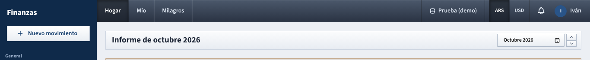
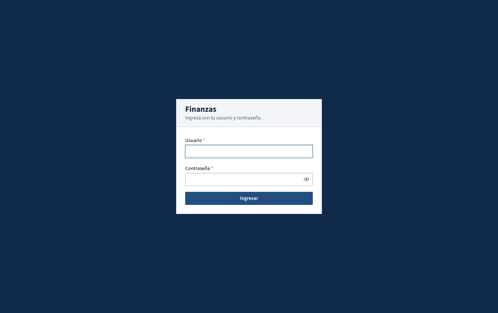

# Ingreso y barra superior

How you get into the app, and the parts of the screen that are there on every page: the top bar, the sidebar, the title strip, the month picker and the footer.

## What you see

### The login screen

- **Ingresá con tu usuario y contraseña.** with the fields **Usuario** and **Contraseña** (the eye icon shows what you typed) and the **Ingresar** button.
- The very first time the app runs, before anyone has an account, the same card shows **Primera configuración: creá tu usuario. Después vas a poder agregar a tu pareja.** instead, with extra fields (see [First setup](#first-setup)).
- Errors appear in a red box above the fields, for example **Usuario o contraseña incorrectos.**

### The top bar, left to right

- **Dashboard tabs**: **Hogar**, **Mío** and your partner's name (for example **Milagros**). They decide whose money the page shows. Your partner's tab only appears if they share their personal dashboard (**Ajustes → Perfil**). The tabs only appear on pages whose content depends on them: **Inicio**, **Movimientos**, **Presupuestos**, **Metas de ahorro**, **Reportes** and **Cierre de mes**. On the other pages they are hidden.
- **Profile switcher**: a database icon with the name of the data profile in use, for example **Prueba (demo)**. See [Perfil de datos](perfil-de-datos.md).
- **ARS / USD**: the display currency. Hovering shows *Convertir montos al dólar BNA del día de cada movimiento*.
- **Bell**: your notifications, with a blue badge counting the unread ones.
- **User menu**: a circle with your initial in your color, and your display name.

### The sidebar

- **Finanzas** at the top takes you to **Inicio**.
- **Nuevo movimiento**: opens the form to record a movement from any page.
- The sections, in order:
  - **General**: **Inicio**, **Movimientos**, **Cuentas**, **Gastos compartidos**.
  - **Planificación**: **Presupuestos**, **Metas de ahorro**, **Reportes**, **Cierre de mes**.
  - **Automatización**: **Importar**, **Reglas**, **Recurrentes**.
  - Then, set apart: **Perfil de datos** and **Ajustes**.
- The page you are on is highlighted in white.

### The title strip

Every page starts with a strip holding its title on the left (for example **Informe de octubre 2026** on Inicio, or **Ajustes**) and that page's buttons on the right, such as the month picker or **Nuevo presupuesto**.

### The month picker

Pages that show one month at a time (**Inicio**, **Presupuestos**, **Cierre de mes**, and some tabs of **Reportes**) have a month picker in the title strip:

- a button with the month and year, for example **Octubre 2026**, and a calendar icon;
- two small arrows next to it: up goes to the next month, down to the previous one.

### The footer

At the bottom of every page:

- **Finanzas v… · uso privado del hogar**: the version you are running (the number goes up with every change). Check it after installing an update.
- **Dólar: BNA · Inflación: IPC INDEC**: where exchange rates and inflation come from.
- Shortcuts to **Ajustes**, **Importar** and **Cierre de mes**.
- **Patch notes**: a simple page listing what changed in each version, newest first, with an index on the left.

### On a phone

On narrow screens (under about 768 pixels wide) the layout changes:

- The sidebar is hidden. Open it with the three-line button at the top left; it closes again when you pick a page or tap **Nuevo movimiento**.
- The top bar shows **Finanzas**, the **ARS / USD** switch, the bell and your initial (without your name).
- The dashboard tabs move to a dark strip just below the top bar, on the pages that use them.
- The profile switcher is not in the top bar. Use **Perfil de datos** in the sidebar instead.
- On very small screens the **Nuevo movimiento** form fills the whole screen.

## What you can do

### First setup

This only happens once, on a new installation with no users.

1. Open the app. The card says **Primera configuración**.
2. Fill in **Usuario** (2 to 40 characters: letters, numbers, dot, hyphen or underscore). This is what you type to log in.
3. Optionally fill in **Nombre para mostrar**, the name shown in the app (for example *Iván*). If you leave it empty, your username is used.
4. Choose a **Contraseña** of at least 10 characters and type it again in **Repetir contraseña**.
5. Click **Crear usuario**. You are logged in straight away.
6. Add your partner in **Ajustes → Hogar → Agregar persona** (see [Ajustes](ajustes.md)).

### Log in

1. Type your **Usuario** (upper or lower case doesn't matter) and **Contraseña**.
2. Click **Ingresar**.

You stay logged in on that browser for 30 days, unless you click **Cerrar sesión**. Changing your password logs you out everywhere else.

### If you get the password wrong

After three wrong attempts for the same username, the app makes you wait before trying again, and each further mistake makes the wait longer:

| Failed attempt | Wait before the next try |
| --- | --- |
| 1st and 2nd | none |
| 3rd | 30 seconds |
| 4th | 1 minute |
| 5th | 5 minutes |
| 6th | 15 minutes |
| 7th and later | 1 hour |

- The message reads *Usuario o contraseña incorrectos. Por seguridad, esperá 30 segundos antes de reintentar.* (longer waits are also given in seconds). The button turns into a countdown, **Esperá 29 s**, and can't be clicked until it reaches zero.
- A correct login clears the count. So does a full day without failed attempts.
- The lock is per username, so one of you getting locked out doesn't block the other. There is also a much higher limit (10 failures) per network address, which only matters if someone tries many usernames from the same place.
- Wrong usernames and wrong passwords give the same message.

There is no "forgot my password" link, and the app has no way to reset someone else's password. Keep your password somewhere safe.

### Switch dashboard and currency

- Click **Hogar**, **Mío** or your partner's name. The page reloads its figures for that dashboard. Your partner's dashboard is for looking only: you can't change their budgets, goals or monthly notes.
- Click **ARS** or **USD**. Nothing stored changes: every amount is converted for display at the BNA quote of its own day ([How the numbers are worked out](como-se-calcula.md)).
- Both choices are remembered in this browser. If you were on your partner's tab and they stop sharing their dashboard, you go back to **Hogar**.

### Switch data profile

1. Click the profile name in the top bar. The menu, titled **Perfil de datos**, lists every profile; the one in use is in bold.
2. Click another profile. Everything reloads, you land on **Inicio**, and a message confirms *Perfil «Prueba (demo)» en uso*.
3. **Administrar perfiles** opens the [Perfil de datos](perfil-de-datos.md) page.

### Read notifications

1. Click the bell. The panel lists your latest 50 notifications (budget alerts, recurring items to confirm, monthly reviews, budgets indexed by inflation), newest first, with the date. Unread ones are in bold. With nothing to show it says **Sin notificaciones.**
2. Click a notification to go to the related page.
3. Closing the panel marks them all as read and clears the badge.

The bell checks for new notifications every minute. Notifications belong to the data profile in use, so switching profile shows a different list.

### Use the user menu

Click your name or initial:

- **Modo oscuro** / **Modo claro**: switch the color scheme. Remembered in this browser.
- **Ajustes**: open the settings.
- **Cerrar sesión**: log out of this browser. The data profile you picked stays selected for next time.

### Record a movement from anywhere

Click **Nuevo movimiento** in the sidebar. The form (**Gasto**, **Ingreso**, **Transferencia** or **Ajuste**) opens on top of the page you're on, and you stay there after saving. See [Movimientos](movimientos.md).

### Pick a month

1. Click the month button to open a small panel with **Mes** (a list) and **Año** (a number from 2000 to 2100). The page updates as you change either.
2. Or use the arrows: up for the next month, down for the previous one.

Each page keeps its own month while you stay on it. When you come back later it starts again on its usual month: the current one on **Inicio** and **Presupuestos**; on **Cierre de mes**, last month during the first 10 days of a month and the current one after that.

## Tips

- If the figures look unfamiliar, check the profile name in the top bar first: you may be on **Prueba (demo)** or the empty **Vacío**.
- The dashboard tabs, the currency and the color scheme are remembered per browser, so each of you can keep your own on your own computer.
- When your session ends (after 30 days, or because you changed your password on another device), the app shows the login screen again. Log in and carry on.

See also: [Guide index](README.md) · [Perfil de datos](perfil-de-datos.md) · [Ajustes](ajustes.md) · [Movimientos](movimientos.md) · [Inicio](inicio.md) · [How the numbers are worked out](como-se-calcula.md)
