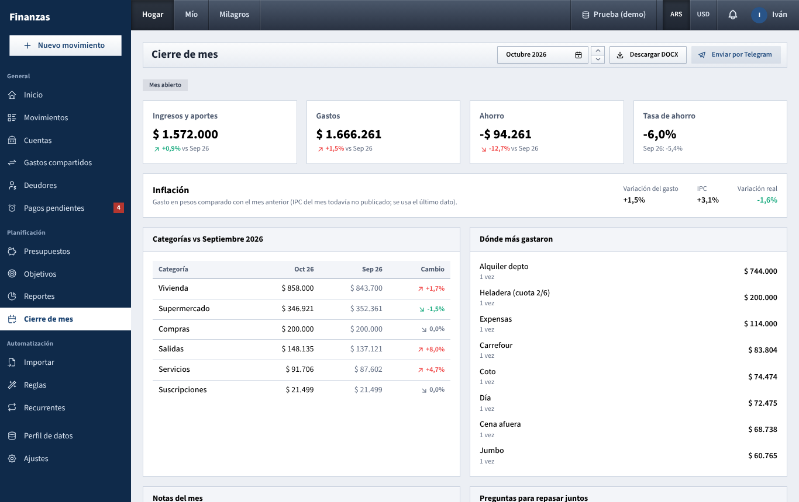

# Cierre de mes

Cierre de mes is the page for your monthly sit-down: the month's numbers next to the previous month, inflation, where the money went, shared notes, and a .docx summary you can download or receive by Telegram.

## What you see

### Header

- The title **Cierre de mes**, with the dashboard name and the month underneath (for example **Hogar · Octubre 2026**).
- The month picker. Until the 10th of the month it opens on the previous month (the one you are closing); from the 11th on, on the current month.
- **Descargar DOCX**: downloads the summary document of the month.
- **Enviar por Telegram**: sends that document by Telegram right away.

### Status badges

- **Mes abierto** (grey) or **Cerrado el** (date) (green) once someone marked the month as closed.
- **Enviado el** (date) (blue) once the document was sent by Telegram, by hand or automatically.

### The four figures

Each compares with the previous month:

- **Ingresos** (or **Ingresos y aportes** when money was put into the joint pot; hover it to see how much), with the change vs last month.
- **Gastos**, with the change vs last month (red when it went up).
- **Ahorro**, with the change vs last month.
- **Tasa de ahorro**, with last month's rate underneath.

These follow the dashboard and currency chosen in the top bar, and count exactly like on [Inicio](inicio.md).

### Inflación

Shown once CPI data has been loaded. It compares this month's spending in pesos with last month's:

- **Variación del gasto**: nominal change.
- **IPC**: the month's inflation.
- **Variación real**: the change after inflation; red when spending grew faster than prices, green when it grew less.

If INDEC has not published the month's CPI yet, the note says so and the latest figure is used. This box is always in pesos, even in USD.

### Categorías vs (previous month)

A table with every category that had spending in either month: this month, last month and **Cambio** (percentage, red when up, green when down). Sorted by this month's amount. Subcategories are added into their parent.

### Dónde más gastaron

The eight places (merchant, or description when there is no merchant) where most was spent this month, with how many times (**vez / veces**) and the total.

### Notas del mes

A free-text box for what you agreed ("Qué salió bien, qué cambiar, decisiones para el mes que viene…").

- Notes save on their own when you click outside the box. While there are unsaved changes, **Sin guardar** appears; **Guardar notas** saves immediately.
- **Marcar mes como cerrado** saves the notes and records the closing date. The button disappears once the month is closed.
- Each dashboard has its own notes per month: **Hogar** notes are shared by both of you, **Mío** notes are yours. On your partner's dashboard the notes are read-only (**Solo podés editar las notas del hogar o las tuyas.**).

### Preguntas para repasar juntos

A fixed checklist to guide the conversation: categories over budget, unexpected expenses, subscriptions to cancel, savings goals, unsettled debts between you, and budgets to change for next month (for example by inflation).

## What you can do

### Do the monthly review

1. Open **Cierre de mes** in the first days of the month; it already shows the month that just ended.
2. Choose the dashboard in the top bar (usually **Hogar**, then each one's **Mío**).
3. Go through the figures, **Inflación**, **Categorías** and **Dónde más gastaron**.
4. Use **Preguntas para repasar juntos** and write your decisions in **Notas del mes**.
5. Click **Marcar mes como cerrado**.

Closing a month is only a marker. It does not lock movements: you can still edit the month, and the page and document will reflect the changes. There is no button to reopen it.

### Download the document

Click **Descargar DOCX**. The file is named after the month and the dashboard, for example `cierre-2026-10-hogar.docx`. It uses the currency currently selected in the top bar.

### Send it by Telegram

Click **Enviar por Telegram**. Unsaved notes are saved first, so they go in the document.

- From **Hogar**, it goes to both of you; from **Mío** (or your partner's dashboard), only to you.
- Each person also gets an in-app notification (the bell in the top bar).
- Only people who linked Telegram in **Ajustes → Notificaciones** and left **Cierre de mes (documento .docx)** switched on receive the file.
- If the server has no Telegram bot configured, you'll get **El bot de Telegram no está configurado.**
- The document sent this way is always in pesos.

### Automatic sending

On days 1 to 3 of each month, the app sends the previous month's document on its own, once per dashboard (**Hogar** and each person's personal one):

- **Hogar** goes to both of you, titled **Cierre de** (month); each personal one goes only to its owner, titled **Cierre de** (month) **(personal)**, with the message "Ya está el resumen del mes. Revísenlo juntos y agreguen notas en Cierre de mes."
- It is skipped for a dashboard whose document was already sent for that month (the **Enviado el** badge), and when there are no movements at all in that month.
- It uses the notes saved at that moment, and amounts in pesos.

## What the document contains

1. The dashboard name (the household name from **Ajustes → Hogar**, or the person's name), the title **Cierre de** (month), the generation date and the BNA quote (of the month's last day, or today if the month is not over).
2. Three boxes: **Ingresos** (or **Ingresos y aportes**) and **Gastos**, each with the change vs last month, and **Ahorro** with the **Tasa de ahorro**. A note explains the contributions when there are any, and a line gives income, spending and savings in the other currency.
3. **Inflación**: spending vs last month and vs a year ago, each with nominal change, CPI and real change (in pesos).
4. **Gastos por categoría**: each category with a bar, amount, **% del total** and change vs last month.
5. **Presupuestos** (only if the dashboard has budgets): budget, spent and percentage used (orange from 80%, red from 100%).
6. **Dónde más gastamos**: the top eight places, times and total.
7. Only for **Hogar**: **Por persona** (each one's share of shared expenses and what each paid) and **Saldo compartido** (who owes whom, or "Están a mano.").
8. **Notas del mes**, or a reminder that notes can be added on this page.

## How the numbers are worked out

- Same rules as [Inicio](inicio.md) and [Reportes](reportes.md): confirmed movements of the chosen dashboard, shared expenses at full amount on **Hogar** and at your share on **Mío**, transfers never counted as spending, contributions to the joint pot counted as money in (Hogar) or out (Mío). See [Cómo se calcula](como-se-calcula.md).
- **Ahorro** = income + contributions − spending. **Tasa de ahorro** = **Ahorro** ÷ (income + contributions into the pot).
- Changes are (this month − last month) ÷ last month. A dash means last month was zero.
- USD amounts use the BNA quote of each movement's day.
- **Saldo compartido** in the document is the balance on the day it is generated, not at the end of the month.

## Tips

- Save the household notes before the 1st if you want them in the automatic document.
- To get the document in dollars, switch to **USD** and use **Descargar DOCX**; **Enviar por Telegram** always sends it in pesos.
- After editing a closed month, download or send the document again to get the updated figures.

See also: [Guide index](README.md) · [Inicio](inicio.md) · [Reportes](reportes.md) · [Presupuestos](presupuestos.md) · [Gastos compartidos](gastos-compartidos.md) · [Ajustes](ajustes.md) · [Login and top bar](barra-superior.md) · [How the numbers are worked out](como-se-calcula.md)
