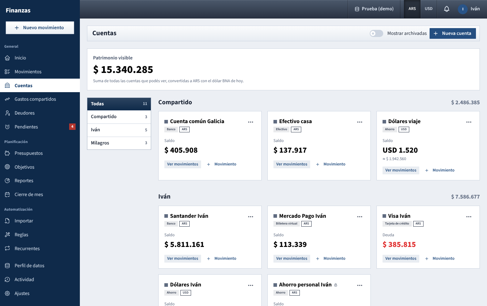

# Cuentas

Your bank accounts, cash, credit cards, savings, investments and digital wallets, with the current balance of each; every movement belongs to one of them.

## What you see

### Header

- **Mostrar archivadas**: when on, archived accounts appear too (faded, with an **Archivada** label). Off by default.
- **Nueva cuenta**: opens the form to create an account.

### Patrimonio visible

The large figure at the top: "Suma de todas las cuentas que podés ver, convertidas a ARS con el dólar BNA de hoy." It follows the **ARS / USD** switch in the top bar. Archived accounts are never included, even with **Mostrar archivadas** on. If an account can't be converted because no exchange rate is loaded, a note says so and that account is left out of the sum.

### Groups

A list on the left picks what to show: **Todas**, **Compartido**, or one of you (with the number of accounts of each). The cards fill the space on the right, under a heading per group with its own subtotal (same conversion, archived accounts left out). On a phone the list becomes a row of tabs above the cards. The choice is kept in the address (for example `?ver=compartido`), so the page reopens the same way.

- **Compartido**: joint accounts, belonging to both of you.
- **Your name**: your personal accounts.
- **Your partner's name**: their personal accounts that aren't private. Their private accounts don't appear at all, not even in the total.

This page shows every account you can see, whatever dashboard tab (**Hogar**, **Mío**…) was selected elsewhere.

### Account cards

Each card shows:

- A colour square, the name and a padlock if the account is private.
- Labels for the type (**Banco**, **Efectivo**, **Tarjeta de crédito**, **Ahorro**, **Inversión**, **Billetera virtual**) and the currency (**ARS** or **USD**).
- **Saldo** and the balance in the account's own currency. A negative balance is shown in red.
- For a credit card with a negative balance, the label reads **Deuda** and the amount is shown as a positive figure in red: it's what you owe on the card.
- When the account's currency differs from the top-bar switch, a smaller line underneath gives the converted value (**≈ $ …**), at today's BNA quote.
- **Ver movimientos**: opens [Movimientos](movimientos.md) filtered to this account.
- **Movimiento**: opens **Nuevo movimiento** with this account already chosen.
- The **···** menu repeats those two (**Ver movimientos**, **Nuevo movimiento**) and, for joint accounts and your own, adds **Editar** and **Eliminar**. Your partner's accounts can't be edited or deleted by you.

If there are no accounts yet, a card says "Todavía no hay cuentas. Creá la primera para empezar a registrar movimientos."

## What you can do

### Create an account

1. Click **Nueva cuenta**.
2. **Nombre**: for example "Banco Nación", "Mercado Pago", "Visa".
3. **Tipo**: **Banco**, **Efectivo**, **Tarjeta de crédito**, **Ahorro**, **Inversión** or **Billetera virtual**. The type changes how a card is labelled (see **Deuda** above) and helps reading; balances work the same for all types.
4. **Moneda**: **ARS** or **USD**. Every movement in the account is in this currency.
5. **Titular**:
   - **Mía (personal)**: yours. It counts in your **Mío** dashboard.
   - **Común (de los dos)**: joint. It counts in **Hogar**, and spending from it doesn't create debts between you.

   You can't create an account on your partner's behalf; they create their own.
6. **Cuenta privada** (personal accounts only): "Tu pareja no verá la cuenta ni sus movimientos (salvo gastos compartidos y pagos de deuda)."
7. **Saldo inicial**: the balance when you start recording movements. "Para tarjetas, una deuda es un saldo negativo." So a card with $ 50.000 already spent and unpaid starts at −50.000.
8. **Color**: optional, used for the square on the card.
9. Click **Guardar**.

### Edit an account

**···** → **Editar**. You can change the name, type, colour, private flag, opening balance and archived state at any time. Two things are locked once the account has movements:

- **Moneda**: "No se puede cambiar la moneda de una cuenta con movimientos."
- **Titular**: "No se puede cambiar el titular de una cuenta con movimientos."

Changing **Saldo inicial** shifts the balance by the difference, as if the account had always started there.

### Make an account private

Turn on **Cuenta privada** when creating or editing a personal account. Your partner then doesn't see the account, its balance or its movements anywhere in the app, and can't record movements in it. Exceptions: a shared expense or shared income recorded there, and a payment you make to settle a debt, are still visible to your partner, with the account shown as **Cuenta privada**. Joint accounts can't be private. More in [the privacy concepts](README.md#privacy).

### Archive an account

For an account you closed or no longer use but whose history you want to keep:

1. **···** → **Editar**.
2. Turn on **Archivada** ("Se oculta de los formularios y del tablero.") and **Guardar**.

An archived account disappears from this page (unless **Mostrar archivadas** is on), from the account choices in **Nuevo movimiento** and from **Saldar**. Its movements stay, and you can still filter **Movimientos** by it. To bring it back, turn on **Mostrar archivadas**, edit it and turn **Archivada** off.

### Delete an account

**···** → **Eliminar** asks "¿Eliminar «name»?". An account with no movements is deleted right away.

If it has movements (or a recurring item), a second window asks again: "«name» tiene N movimientos. Se eliminan junto con la cuenta, igual que sus recurrentes." **Eliminar con sus movimientos** deletes the account with every movement in it, transfers to and from it included (so the other account's balance changes too), and its recurring items. Import history stays. If one of those transfers goes to your partner's private account, the deletion is refused: archive the account instead.

The message at the bottom reads "Cuenta «name» eliminada con sus N movimientos" and offers **Deshacer** for a few seconds, which brings everything back as it was (see [Undo an action](barra-superior.md#undo-an-action)). To keep the history, archive the account instead of deleting it.

### Fix a balance that doesn't match the bank

Two ways:

- **Ajuste** movement (**Movimiento** on the card, then the **Ajuste** tab): enter the difference, negative to subtract. It's dated, so the history shows when the correction happened, and it doesn't count as income or spending. Best for differences that appear along the way.
- Change **Saldo inicial**: best when the starting figure was simply wrong.

## How the numbers are worked out

**Balance of an account** = **Saldo inicial**, plus every confirmed movement in it dated today or earlier:

- **Gasto**: subtracts the amount.
- **Ingreso**: adds the amount.
- **Ajuste**: adds its amount (which may be negative).
- **Transferencia**: subtracts the amount from the origin and adds it to the destination. For a transfer between currencies, the destination receives the **Monto recibido** (the amount at the rate you set).

Not included:

- **Pending** movements (recurring items not yet confirmed).
- Movements dated in the future, such as the remaining installments of a **Compra en cuotas**. Each one enters the balance on its date.

Shared expenses affect only the account they were paid from, at their full amount. What your partner owes you for them is tracked separately in [Gastos compartidos](gastos-compartidos.md), not in balances.

**Converted amounts on this page** (the **≈** line, the group subtotals and **Patrimonio visible**) use **today's** BNA quote for every account. That's different from income and spending elsewhere in the app, which use the quote of each movement's own day. See [currency conversion](como-se-calcula.md).

## Tips

- Create a personal **Efectivo** account for each of you if you ever pay each other back in cash: settling up needs a personal account on each side in the same currency.
- Keep dollars in their own **USD** account and buy them with a **Transferencia** from a peso account, so the purchase isn't counted as spending.
- Credit cards: record purchases as expenses on the card account, and paying the card as a **Transferencia** from the bank to the card.

See also: [Guide index](README.md) · [Movimientos](movimientos.md) · [Gastos compartidos](gastos-compartidos.md) · [Objetivos](metas.md) · [Reportes](reportes.md) · [How the numbers are worked out](como-se-calcula.md) · [Login and top bar](barra-superior.md)
