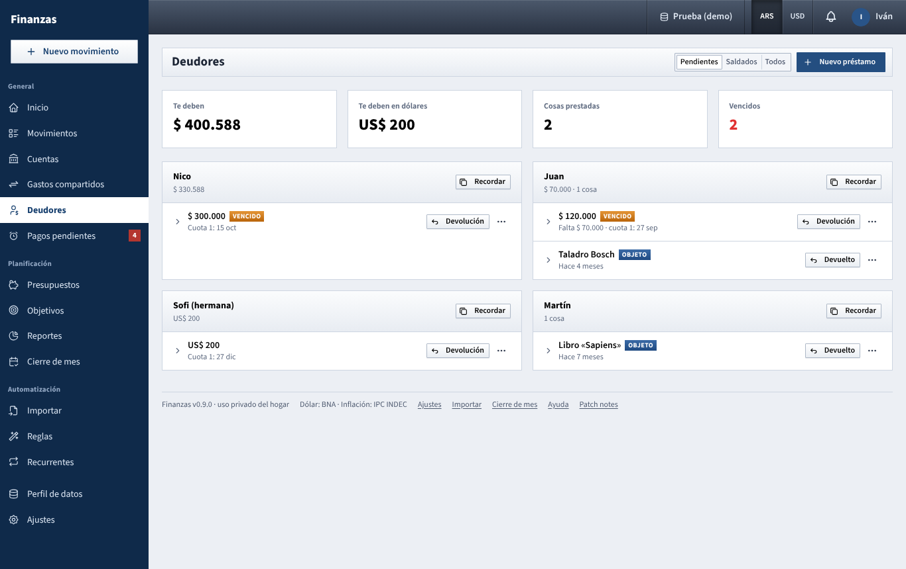

# Deudores

Keep track of money and things you lent to other people, what came back, and what is still out.

Loans don't touch your accounts, balances or reports. Each of you only sees your own list. Loans with a return date or installments also appear in [Pagos pendientes](pagos-pendientes.md) as **TE DEBEN**, so the app chases you until they come back.

## What you see

- **Pendientes / Saldados / Todos** (top right): what to list. **Pendientes** is the default.
- Four figures across the top:
  - **Te deben**: pesos still owed to you, across everyone.
  - **Te deben en dólares**: the same in dollars.
  - **Cosas prestadas**: things lent and not yet returned.
  - **Vencidos**: loans past their **Devolver antes de** date, in red when there are any.
- **One card per person**, people with something overdue first, then whoever owes more. The title strip shows the name and what they still owe (for example *$ 70.000,00 · 1 cosa*).
- **One row per loan**, kept short:
  - the amount (or the thing, with an **OBJETO** tag), and **VENCIDO** when its date passed;
  - one line below it: what's missing and the next date (*Falta $ 70.000 · cuota 1: 27 sep*, *Vence 27 sep*), or how long ago you lent it (*Hace 4 meses*), or *Devuelto el 3 oct* once closed (closed loans are faded);
  - **Devolución** (or **Devuelto**) and the **⋯** menu on the right.
- **Click a row** (the ▸ on its left) for the details: what it was for, the date you lent it, **Devolver antes del**, the plan (installments and interest), how much came back with a bar, each return with its reason, and the notes.

## What you can do

### Write down a loan

1. Click **Nuevo préstamo**.
2. Choose **Dinero** or **Objeto**.
3. **¿A quién?**: type a name. People you've used before are suggested, so the same person always groups together.
4. For money: **Monto** and the currency, and optionally **¿Para qué?**. For a thing: **¿Qué le prestaste?**
5. **Fecha** (today by default) and, if you agreed on one, **Devolver antes de**.
6. Optionally **Con interés o en cuotas** (money only):
   - **Interés mensual**: a percentage, or **Usar la inflación de …** to fill in last month's CPI so the money keeps its value.
   - **Cuotas**: how many payments (1 for a single one).
   - **Primera cuota**: when the first one is due; the rest fall on the same day of the following months.
   - A line shows the result, for example *3 cuotas de $ 35.421,03 · total $ 106.263,09 (interés $ 6.263,09)*. With interest, the installments are fixed (French system); a single payment accrues compound interest for the months until it's due.
7. **Guardar**.

Once saved, **the interest, the installments, the amount and the dates are fixed**: **Editar** only changes the person, the reason and the notes.

### Something came back

- Money: click **Devolución** on the row and type how much (it starts with what's due now: the current installment, or the rest). If it's less, it's a partial return and **you have to say why** (*¿Por qué es parcial?*); the rest stays pending. When returns cover the whole amount, the loan closes (*Devuelto el …*). An income movement with exactly the installment amount, in your account, is recorded as a return on its own.
- A thing: click **Devuelto** and confirm the date.

### Ask for it back

Click **Recordar** on a person's card. A friendly message listing everything they still have is copied, ready to paste in WhatsApp, for example: *¡Hola Juan! Te escribo para no olvidarme: tengo anotado que te presté $ 70.000,00 (Para el seguro del auto, del 27/08) y Taladro Bosch (desde el 27/06). ¿Cuándo te queda cómodo devolverlo?*

### Other actions (the ⋯ menu)

- **Editar** any detail.
- **Perdonar lo que falta**: close a money loan without expecting the rest.
- **Reabrir** a closed loan.
- **Eliminar** it, with its returns.

## Tips

- Write it down the moment you lend: the date is what later tells you *hace 7 meses*.
- Setting **Devolver antes de** is what makes overdue loans stand out.
- The demo profile has a few sample loans of Iván's (Juan, Sofi, Martín, Lucas, Caro).

See also: [Guide index](README.md) · [Gastos compartidos](gastos-compartidos.md) · [Login and top bar](barra-superior.md)
