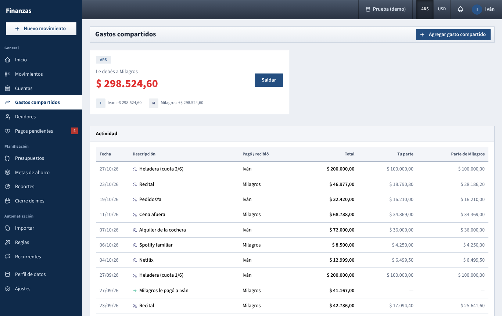

# Gastos compartidos

Who paid what for the two of you, and how much one owes the other, Splitwise style, with a button to settle up.

## What you see

### Header

**Agregar gasto compartido** opens the **Nuevo movimiento** form on **Gasto**. Turn on **Gasto compartido** in the form before saving (it starts off). See [shared expense and shared income](movimientos.md#shared-expense-and-shared-income).

### Balance cards

One card per currency in which there's something to settle (**ARS**, **USD**). Pesos and dollars are never mixed: a debt in dollars is paid in dollars.

Each card shows:

- The currency label.
- The result, from your point of view:
  - **Le debés a Milagros** in red: you owe.
  - **Milagros te debe** in green: you're owed.
  - **Están a mano** with a tick: nobody owes anything in this currency.
- **Saldar**, next to the amount, to record the payment (see [Settle up](#settle-up)).
- At the bottom, each person's net position with a sign: **+** means that person is owed money, **−** means they owe. The two always add up to zero.

If no shared expense has ever been paid from a personal account, a single card says **Están a mano**, "Todavía no hay gastos compartidos pagados con cuentas personales."

### Actividad

The latest 100 shared movements and debt payments dated today or earlier, newest first. Pending movements and future installments aren't listed until they count.

| Column | Shows |
| --- | --- |
| **Fecha** | Day, as DD/MM/YY. |
| **Descripción** | A people icon and the description for shared expenses and income. An arrow and "Milagros le pagó a Iván" for a debt payment. |
| **Pagó** | Whose account it came from (for shared income, whose account it entered). **Cuenta común** when it was a joint account. |
| **Total** | The full amount. |
| **Tu parte** / **Parte de Milagros** | Each person's share. A dash for debt payments. |

Click a row to open the movement. Shared expenses paid from joint accounts are listed too, even though they don't create debt.

## What you can do

### Record a shared expense

1. Click **Agregar gasto compartido** (or **Nuevo movimiento** anywhere).
2. Enter amount, date, the account it was paid from and a description.
3. Turn on **Gasto compartido** and choose the **División** (default, equal, percentages or exact amounts).
4. **Guardar**.

If you paid from your personal account, your partner now owes you their part. If you paid from a joint account, nothing changes here: see [Joint accounts](#joint-accounts-no-debt).

You can also mark something as shared afterwards: open it from **Movimientos**, turn on the switch and save.

### Record shared income

Same steps with **Ingreso** and **Ingreso compartido**: for money that belongs to both of you but entered one person's account (a refund for a shared purchase, a deposit returned, rent collected). Whoever received it owes the other their share.

### Settle up

1. Click **Saldar** on the card of the currency you want to settle.
2. The **Saldar deuda** window explains: "Iván le paga a Milagros. Se registra como una transferencia entre sus cuentas personales y no cuenta como gasto."
3. **Sale de (Iván)**: the payer's account. **Entra a (Milagros)**: the receiver's account. Both lists offer only personal, non-archived accounts in that currency; your partner's private accounts don't appear. The first account of each person is preselected.
4. **Monto**: filled in with the full debt. Lower it for a partial payment.
5. **Fecha**: today by default.
6. **Nota**: optional; it becomes the movement's description (**Saldar deudas** if left empty).
7. **Registrar pago**.

The payment is saved as a **Transferencia** marked as a debt payment. It moves money between the two accounts, changes both balances, appears in **Movimientos** as **Pago de deuda**, and doesn't count as income or spending for either of you.

If one of you has no suitable account, a yellow notice says "Cada uno necesita al menos una cuenta personal (no privada) en ARS. Podés crear una cuenta de efectivo si el pago fue en mano." Create one in [Cuentas](cuentas.md) and try again.

You can also record the payment by hand: in **Nuevo movimiento**, choose **Transferencia** from one partner's personal account to the other's and leave **Es un pago para saldar deudas entre nosotros** ticked.

### Correct a mistake

Open the movement from **Actividad** (or **Movimientos**) and edit or delete it. The balance is recalculated straight away from what's recorded, so there's nothing else to undo.

## How the numbers are worked out

The app keeps a running position for each person, separately in each currency. It goes through every confirmed movement dated today or earlier:

**Shared expense paid from a personal account.** The payer is credited with the full amount; each person, the payer included, is debited with their own share.

> Iván pays $ 10.000 for dinner from his Santander, split 50/50. Iván: +10.000 − 5.000 = **+5.000**. Milagros: **−5.000**. Card for Iván: **Milagros te debe $ 5.000**.

**Shared income received in a personal account.** The reverse: whoever received it is debited with the full amount, and each person is credited with their share.

> Milagros receives a $ 8.000 refund for a shared purchase in her account, split 50/50. Milagros: −8.000 + 4.000 = **−4.000**. Iván: **+4.000**.

**Debt payment** (a transfer between the two personal accounts, marked as a settlement). The payer is credited with the amount, the receiver debited. A full payment brings both back to zero.

**Then** the positions are compared: whoever is negative owes the amount to whoever is positive. That's the figure on the card.

What doesn't count:

- Pending movements, until someone confirms them.
- Movements dated in the future, such as upcoming installments of a shared **Compra en cuotas**. Each installment adds to the balance on its own date.
- Plain transfers between you with the settlement box unticked.
- Anything that isn't marked shared, even if it was for both of you.

### Joint accounts (no debt)

A shared expense paid from a joint account, or shared income received in one, creates no debt: the joint pot already belongs to both of you. The split still matters, because it decides how much counts in each person's **Mío** dashboard.

Money you put into a joint account (a transfer from your personal account) is a contribution, not a loan. It doesn't appear here either.

The split itself (default ratio, rounding to the cent so the parts add up exactly) is explained in [How the numbers are worked out](como-se-calcula.md). The default ratio is set in **Ajustes → Hogar**.

## Tips

- Settle in the currency of the debt. If you owe in dollars but want to pay in pesos, record the payment in dollars from a USD account, or agree on it outside the app.
- Partial payments are fine: the card simply shows what's left.
- A shared expense your partner paid from a private account still appears in **Actividad** and counts here; you just don't see which account it came from.

See also: [README.md](README.md) · [movimientos.md](movimientos.md) · [cuentas.md](cuentas.md) · [inicio.md](inicio.md) · [ajustes.md](ajustes.md) · [como-se-calcula.md](como-se-calcula.md)
