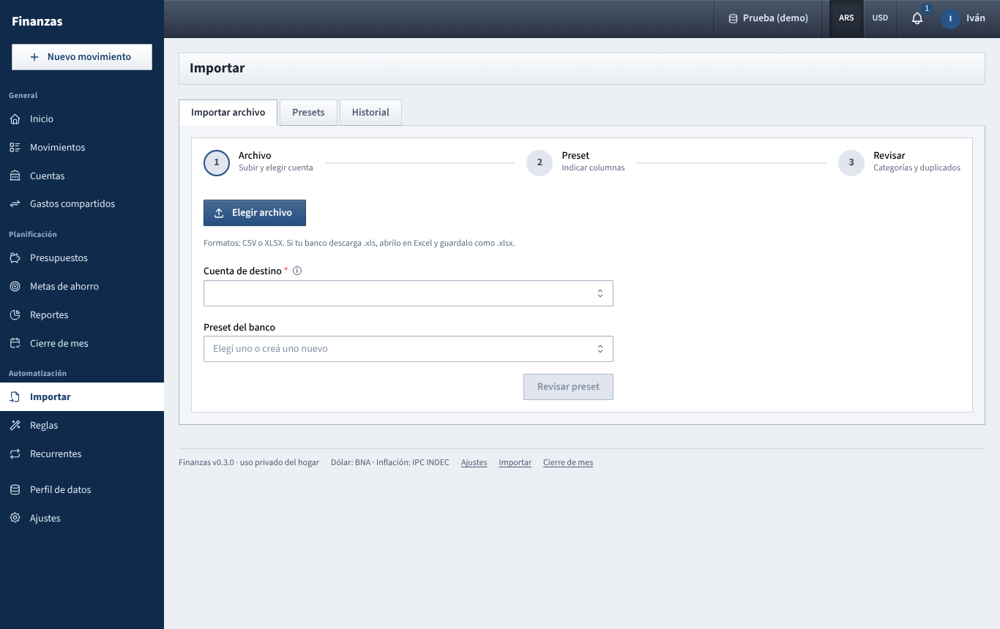

# Importar

Load the movements of a bank, card or wallet statement from a CSV or Excel file instead of typing them one by one.

## What you see

Three tabs:

- **Importar archivo**: the import wizard, in three steps: **Archivo** (upload and choose the account), **Preset** (describe the columns) and **Revisar** (check categories and duplicates).
- **Presets**: the saved layouts, one per bank or statement type.
- **Historial**: the last 50 imports, with **Deshacer**.

A **preset** describes how one bank lays out its file: which column has the date, the description and the amount, how dates and numbers are written, and which rows to skip. You set it up once per bank and reuse it every time.

## What you can do

### Import a file

**Step 1: Archivo**

1. Click **Elegir archivo** and pick a **.csv** or **.xlsx** file. Old **.xls** files are not supported: open them in Excel and save as .xlsx or .csv.
2. Choose the **Cuenta de destino**: every row goes into this account, in its currency. Only accounts you can write to are listed.
3. Choose the **Preset del banco**, or **Crear preset nuevo…** for a bank you have not imported before. If the preset has a default account and you have not chosen one, it is filled in.
4. With a saved preset, click **Vista previa** to go straight to step 3, or **Revisar preset** to check it first. With a new preset, click **Configurar columnas**.

**Step 2: Preset**

The bottom of this step shows **Vista del archivo**: the first 60 rows, with columns labeled A, B, C… and colored badges for the role you gave each one (**Fecha**, **Descripción**, **Monto**…). Skipped rows are grey, the header row is bold and ignored rows are struck through, so you can see the effect of each setting as you change it.

Settings:

- **Separador** (CSV only): **Automático** usually works; otherwise **Punto y coma**, **Coma**, **Tabulación** or **Barra**.
- **Codificación**: **UTF-8** or **Windows-1252**. If accents look broken (*é*), switch to the other one.
- **Hoja (Excel)**: 1 is the first sheet.
- **Filas a saltear**: rows before the header (bank name, account number, dates of the statement).
- **La primera fila (después de saltear) es el encabezado**: on when the file has column titles. The titles then appear next to the letters in the column lists.
- **Columna de fecha** and **Formato de fecha**: DD/MM/YYYY, DD/MM/YY, DD-MM-YYYY, DD.MM.YYYY, MM/DD/YYYY or YYYY-MM-DD. Dates written as YYYY-MM-DD and real Excel date cells are read correctly whatever the format says. Two-digit years are read as 20YY.
- **Columna(s) de descripción**: one or more. Several are joined with " - ".
- **Montos**:
  - **Una columna con signo**: choose **Columna de monto**. Negative means money out. Turn on **Los gastos vienen en positivo** for card statements that list purchases as positive numbers.
  - **Columnas débito y crédito**: choose **Columna de débito (salidas)** and **Columna de crédito (entradas)**.
  - **Separador decimal**: **Coma (1.234,56)** or **Punto (1,234.56)**.
- **Columna de moneda (opcional)**: rows whose currency does not match the account are flagged.
- **Columna de comercio (opcional)** and **Columna de notas (opcional)**.
- **Ignorar filas que contengan**: texts such as *SALDO ANTERIOR* or *TOTAL*; press Enter after each. Any row containing one of them is left out.

To keep the layout, type a **Nombre del preset** (for example *Galicia - caja de ahorro*) and click **Guardar preset** (or **Guardar cambios** for an existing one). The chosen destination account is saved as the preset's default account. Then click **Vista previa**.

**Step 3: Revisar**

At the top: how many rows were read, how many will be imported, how many are duplicates and how many have no category, plus the total **Salidas** and **Entradas** of the selected rows (transfers left out).

If some rows could not be read, a yellow box says how many; **Ver detalle** lists the line numbers and the reason (*Fecha no reconocida*, *Monto vacío o no reconocido*). Many errors usually mean a wrong column, date format or number of rows to skip: click **Volver al preset**.

For each row you can:

- tick or untick it (the checkbox on the left);
- change the **Tipo**: **Gasto**, **Ingreso** or **Transferencia**;
- choose the **Categoría**, or for a transfer the other account (*Hacia la cuenta…* for money out, *Desde la cuenta…* for money in);
- turn on **Compartido** (expenses only). Shared rows use the household's default split, see [Gastos compartidos](gastos-compartidos.md).

The **Info** column shows badges:

- **Regla**: a rule filled this row (hover to see which). See [Reglas](reglas.md).
- **Duplicado**: this exact row was imported before. Unticked by default.
- **Posible duplicado**: there is already a movement in this account with the same date and amount (for example one you typed by hand). Still ticked; check it.
- **Otra moneda**: the row's currency differs from the account's. Unticked by default.

Bulk tools above the table:

- choose **Gastos** or **Ingresos**, a category, and click **Asignar categoría a seleccionados** to set it on every ticked row of that type (this replaces categories set by rules);
- **Seleccionar todos (sin duplicados)** and **Ninguno**.

Rows are shown 50 per page. When ready, click **Importar N movimientos**. The result says how many were imported and lists any row that failed with the reason.

### Manage presets

In the **Presets** tab you see each preset's name, default account and how it reads amounts and dates. Use the pencil to edit it (without a file, pick columns by letter; to see them over a real file, edit it from the **Importar archivo** tab) or the trash icon to delete it. Deleting a preset does not change movements already imported. Presets are shared by both of you.

### Undo an import

1. Open **Historial**. Each import shows the date, file, account, who did it and how many movements it still has (*8 / 10* if two were deleted since).
2. Click **Deshacer** and confirm.

Every movement that import created and that still exists is deleted, even if you edited it afterwards. Nothing else is touched.

## How the numbers are worked out

- **Amounts in one column**: the sign decides the direction. Amounts in parentheses, like *(1.500,00)*, or with a trailing minus, like *1.500,00-*, count as negative. Currency symbols and spaces are ignored.
- **Debit and credit columns**: amount = credit − debit, ignoring any sign inside those columns. Rows where both are empty or zero are reported as errors.
- **Duplicates**: a row is a **Duplicado** when an earlier import already brought a row with the same account, date, amount and description (ignoring case and extra spaces). Two identical rows in the same file are both imported.
- **Transfers**: a money-out row becomes a transfer from the destination account to the chosen account; a money-in row becomes a transfer from the chosen account into the destination account. If the two accounts have different currencies, the other side is converted at the BNA quote of that day; without a quote for that date the row fails.

## Tips

- Imported movements are never marked private. Mark them afterwards in **Movimientos** if needed.
- The uploaded file is kept for 30 minutes. After that you see *El archivo expiró. Volvé a subirlo.*
- Create rules for the descriptions you see every month; the next import comes out categorized. See [Reglas](reglas.md).
- Import each statement into the right account: the duplicate check is per account.

See also: [Guide index](README.md) · [Reglas](reglas.md) · [Movimientos](movimientos.md) · [Cuentas](cuentas.md) · [Gastos compartidos](gastos-compartidos.md) · [Recurrentes](recurrentes.md)
