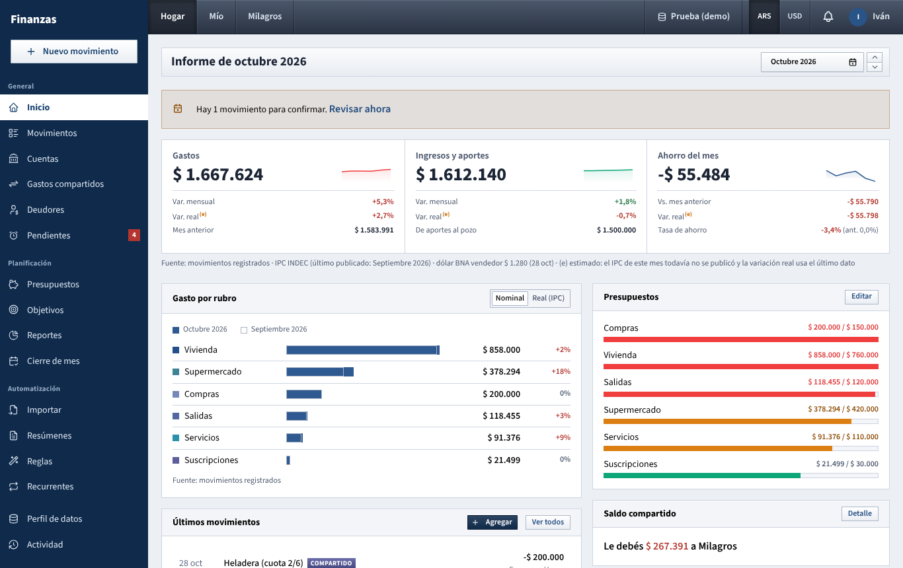

# Inicio

The home page is a one-screen report of a month for the dashboard you have selected (**Hogar**, **Mío** or your partner's): what came in, what went out, what was saved, and where things stand.

## What you see

### Header

- The title reads **Informe de** followed by the month, for example **Informe de octubre 2026**.
- Under it: the dashboard name (**Hogar**, **Mis finanzas** or your partner's name), the display currency (**montos en ARS** or **montos en USD**) and the latest BNA sell quote with its date, for example **dólar BNA vendedor $ 1.274,00 (23 oct)**.
- On the right, the month picker. Click the month to choose a month and year, or use the small up and down arrows to move one month forward or back. It opens on the current month.

### Alerts (only when they apply)

- **Primeros pasos**: shown when the month has no movements and the dashboard has no accounts yet. It points you to **Cuentas** and **Importar**.
- **Faltan cotizaciones del dólar BNA…**: some movements could not be converted to the other currency because there is no quote at all. Those amounts count as zero until you load quotes in **Ajustes**.
- **Hay N movimientos recurrentes para confirmar**: recurring bills are waiting for you. **Revisar ahora** opens **Recurrentes**.

### The three headline figures

Three columns summarise the month. Each has a small line chart of the last 6 months (hover it to see "Últimos 6 meses"); it is hidden when all six months are zero.

| Column | Big figure | Rows underneath |
| --- | --- | --- |
| **Gastos** | Total spending of the month | **Var. mensual** (change vs last month), **Var. real** (the same change after inflation), **Mes anterior** (last month's total) |
| **Ingresos** or **Ingresos y aportes** | Income, plus money put into the joint pot | **Var. mensual**, **Var. real**, and either **Mes anterior** or the contributions line (see below) |
| **Ahorro del mes** | Income and contributions minus spending | **Vs. mes anterior** (difference in money), **Var. real**, **Tasa de ahorro** with last month's rate in brackets (**ant.**) |

Colors follow meaning: green when the change is good for your savings (less spending, more income), red when it is bad.

The third row of the income column changes with the dashboard:

- On **Hogar**, when partners moved money into the joint account, the column is titled **Ingresos y aportes** and shows **De aportes al pozo** with that amount.
- On **Mío**, when you moved money into the joint account, it shows **Aportaste al hogar** with that amount. That money is already subtracted from your **Ahorro del mes**.
- With no contributions, it shows **Mes anterior**.

**Var. real** is marked **(e)** (estimated) when INDEC has not yet published the CPI for the month you are looking at. In USD it always shows a dash, because the inflation adjustment only applies to pesos.

Below the three columns, a **Fuente:** line says where the numbers come from: recorded movements, the BNA quote of each movement's day (in USD), the latest published INDEC CPI (in ARS), and what **(e)** means.

### Gasto por rubro

Spending of the month per top-level category (subcategories are added into their parent), largest first. Each row has:

- a solid bar for this month and an outlined "ghost" bar for last month, on the same scale;
- the amount for this month;
- the percentage change vs last month.

The **Nominal / Real (IPC)** switch in the corner changes what last month is compared in. With **Real (IPC)**, last month's amounts are raised by the month's inflation (the legend reads "en pesos de hoy"), so the percentage shows whether you spent more or less after inflation. The switch only works in ARS; in USD it is greyed out.

Only categories with spending this month are listed. With no spending yet you'll see a hint to use **Nuevo movimiento** or import a bank statement.

### Últimos movimientos

The eight most recent confirmed movements of this dashboard, up to today. Besides income and expenses, it also lists transfers that touch one of the dashboard's accounts. **Agregar** opens the new movement form; **Ver todos** goes to [Movimientos](movimientos.md).

This list always shows the latest movements, even when you pick an earlier month.

### Right-hand column

- **Presupuestos**: up to six budgets of this dashboard for the chosen month, the most used first, each with "spent / budget" and a bar. Orange from 80%, red at 100% or more. **Editar** goes to [Presupuestos](presupuestos.md). If there are none: **Sin presupuestos para este tablero** with a **Definir presupuestos** link.
- **Saldo compartido**: who owes whom for shared expenses, one line per currency, for example **Le debés $ 201.499,60 a Milagros** or **Milagros te debe …**. **Están a mano.** when nobody owes anything. It is the same on every dashboard and always reflects today, not the selected month. **Detalle** opens [Gastos compartidos](gastos-compartidos.md).
- **Cuentas**: the dashboard's active (not archived) accounts with today's balance in their own currency, and a **Total** in the display currency. Hover an account in the other currency to see its converted value "al dólar BNA de hoy". On **Hogar** these are the joint accounts; on **Mío**, your own. A partner's private accounts never appear.
- **Cuotas comprometidas** (only if there are any): future installments already scheduled, month by month, up to six months ahead.
- **Metas de ahorro** (only if there are any): up to three active goals of this dashboard, with percentage, saved vs target and how much is still needed per month. **Ver metas** goes to [Metas](metas.md).

## What you can do

- **Look at another month**: use the month picker in the header. Everything follows the month except **Últimos movimientos**, **Saldo compartido**, **Cuentas**, **Cuotas comprometidas** and **Metas de ahorro**, which always show the current state.
- **Switch dashboard or currency**: use **Hogar / Mío / partner** and **ARS / USD** in the top bar (see [Barra superior](barra-superior.md)).
- **Check spending against inflation**: in **Gasto por rubro**, switch to **Real (IPC)** (ARS only).
- **Add a movement**: **Agregar** in **Últimos movimientos**, or **Nuevo movimiento** in the side menu.
- **Confirm pending recurring bills**: click **Revisar ahora** in the alert.

## How the numbers are worked out

- **Which movements count**: only confirmed movements (pending recurring bills are left out) that belong to the dashboard. On **Hogar**: movements of joint accounts, plus shared expenses from any account at their full amount. On **Mío**: your own accounts, but shared expenses only at your share, wherever they were paid from. Transfers between accounts are never income or spending. See [Cómo se calcula](como-se-calcula.md).
- **Contributions (aportes)**: a transfer from a personal account into a joint account adds to **Hogar** and subtracts from that person's **Mío**. A transfer back out of the joint account does the opposite.
- **Ahorro del mes** = income + contributions − spending.
- **Tasa de ahorro** = **Ahorro del mes** ÷ (income + contributions into the pot), as a percentage with one decimal. It shows a dash when there was no income.
- **Var. mensual** = (this month − last month) ÷ last month. A dash means last month was zero.
- **Var. real** = (1 + monthly change) ÷ (1 + the month's CPI) − 1. If the month's CPI is not published yet, it is estimated with the latest published monthly rate, hence **(e)**.
- The **Var. real** of **Ahorro del mes** is a money difference: this month's savings minus last month's savings raised by the month's CPI.
- **USD**: every movement is converted at the BNA quote of its own day (sell, buy or average, as set in **Ajustes → Hogar**). Account balances, **Total** and **Cuotas comprometidas** are converted at today's quote instead.
- **Budgets** are measured in the budget's own currency, and a budget on a parent category includes its subcategories.

## Tips

- The header quote is always the BNA **sell** quote, even if your household converts with the buy or average quote.
- Early in a month, look at the previous month first: the current one is still filling up, and its CPI is not published yet.
- If the income column looks empty on **Hogar**, record your transfers into the joint account: they are what the household "earns".

See also: [Guide index](README.md) · [Login and top bar](barra-superior.md) · [Movimientos](movimientos.md) · [Presupuestos](presupuestos.md) · [Gastos compartidos](gastos-compartidos.md) · [Metas de ahorro](metas.md) · [Reportes](reportes.md) · [How the numbers are worked out](como-se-calcula.md)
