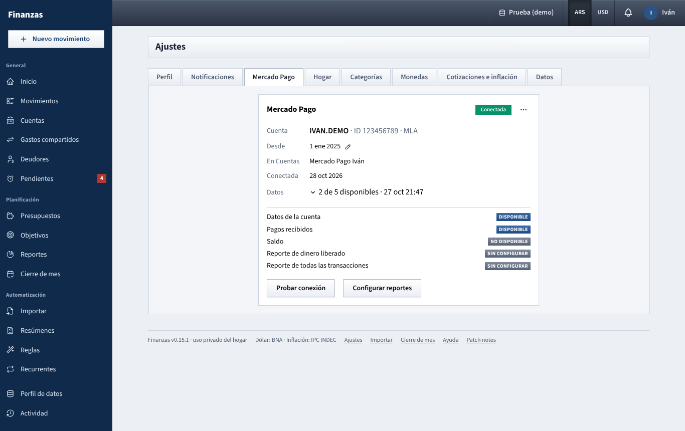
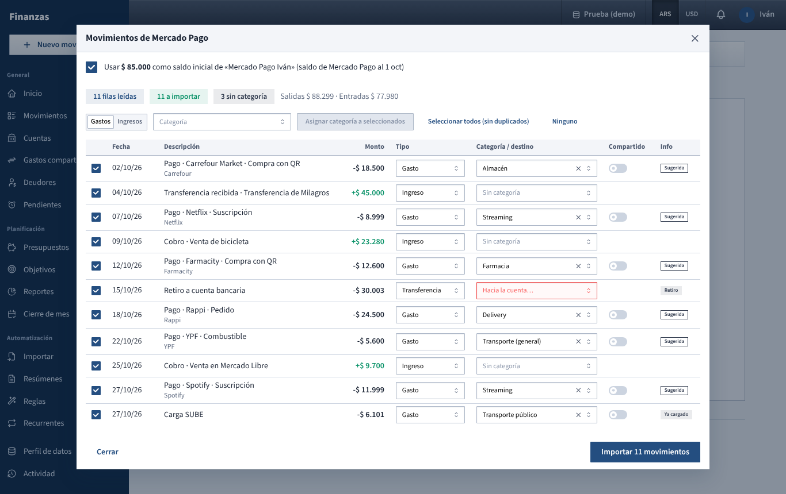

# Connect Mercado Pago

Each of you can connect your own personal Mercado Pago account in **Ajustes → Mercado Pago**. The app then brings your Mercado Pago movements into your Mercado Pago account in [Cuentas](cuentas.md): the first time everything since the start date, for you to review; after that, new movements every 3 hours by themselves.

## Before you start

Mercado Pago gives a personal account one key, the **Access Token** of production. It is powerful: anyone who has it can read your whole account **and move money** with it (there is no read-only version). So:

- Never paste it in a chat, an email, a screenshot or a file. Type it only in **Ajustes → Mercado Pago**.
- If you think it leaked, renew it in Mercado Pago (**Credenciales de producción → Renovar**): the old one stops working at once.

How Finanzas keeps it:

- It's checked with Mercado Pago, then stored **encrypted**. The key that opens it is not in the database, so a copy of the database or a backup alone is useless.
- It's **never shown again**, not even to you: the screen only shows the account name and ID.
- It's yours only. Your partner can't see it, use it or even tell whether you connected one.
- The app only **reads** from Mercado Pago, with one exception you approved: it can save the settings of the two history reports and ask for a report (that's how it gets your movements). It's built so it can't create payments, refunds, transfers or anything else that moves money.

## Get the token (about 15 minutes, on a computer)

1. Your Mercado Pago identity must be verified (DNI and selfie in the app).
2. Go to **mercadopago.com.ar/developers/panel/app** and log in with your personal account.
3. **Crear aplicación**:
   - **Elegí una solución para integrar**: **Checkout API**.
   - **Nombre de la aplicación**: for example *Finanzas*. Answer the rest with the simplest option.
   - Accept and click **Crear aplicación**.
4. In the app's menu: **Producción → Credenciales de producción**. If asked, activate them (**Industria**: *Servicios* or *Otros*; **Sitio web**: any address of yours, for example your GitHub profile).
5. Copy the **Access Token**. It starts with `APP_USR-`. The **Public Key**, Client ID and Client Secret aren't needed.

Each of you does this with your own Mercado Pago login.

## Connect it

1. In Finanzas: **Ajustes → Mercado Pago**.
2. Paste the token in **Access Token de producción**.
3. **Traer movimientos desde**: how far back to bring movements once that's available. It starts on **1 October 2026**.
4. Click **Conectar**. The app asks Mercado Pago who the token belongs to, and only saves it if it's valid.

### Your Mercado Pago account in Cuentas

Each of you has **one** Mercado Pago account in [Cuentas](cuentas.md), and the connection fills that one:

- If you have none (no personal account named *Mercado Pago*, *MercadoPago* or *MP*), connecting creates **Mercado Pago**: a digital wallet in pesos, yours, starting at $ 0.
- If you already have one, a window asks **¿Cuál es tu cuenta de Mercado Pago?** on whatever page you are. Pick it and click **Asignar**. The window can't be closed without choosing, and you can't make another one.
- Once assigned, creating a second Mercado Pago account of your own is refused.
- This is per data profile: in another profile (for example **Prueba (demo)**) the same happens the first time you open the app there.

Common messages:

| Message | Fix |
| --- | --- |
| *Es un token de prueba* | You copied the test one. Use **Credenciales de producción**. |
| *El token debe empezar con APP_USR-* | Copy it again, whole. |
| *Mercado Pago rechazó el token* | It's wrong or was renewed. Copy the current one. |
| *No se pudo contactar a Mercado Pago* | No internet on the server, or Mercado Pago is down. Try later. |

## Once connected

- **Cuenta**: your Mercado Pago name, user ID and country (**MLA** is Argentina).
- **Desde**: the start date (1 October 2026 unless you changed it); the pencil changes it.
- **En Cuentas**: the account it fills.
- **Movimientos**: how the import is going (see [Bring in your movements](#bring-in-your-movements)).
- **Saldo**: your available balance according to Mercado Pago, with the time of that figure. If the app's balance for the account is different, a line underneath says **En la app: $ …**: something is missing, doubled or typed with another amount.
- **Datos**: after **Probar conexión**, how many data sources your account allows. Click it for the list:
  - **Datos de la cuenta**: who you are.
  - **Pagos recibidos**: money that came in, almost in real time.
  - **Saldo**: the live balance. Mercado Pago often blocks it for personal accounts; that's normal.
  - **Reporte de dinero liberado** and **Reporte de todas las transacciones**: the full history, in and out. **Sin configurar** means Mercado Pago has no settings for that report yet: click **Configurar reportes** (below).
- **Configurar reportes** (only while a report shows **Sin configurar**): saves the report's settings in Mercado Pago (every column, Argentina's time, no emails, no automatic schedule) and checks again. Reports already set up are left as they are. If Mercado Pago refuses the list of columns, the app tries simpler ones, down to the short list from Mercado Pago's own example. If that's refused too, the message says which report, its code and Mercado Pago's reason; then try generating one by hand on the website (**Tu negocio → Reportes**) and click **Probar conexión** again.
- **⋯ → Reemplazar token**: after renewing it in Mercado Pago.
- **⋯ → Desconectar**: deletes the token from Finanzas. To cancel it in Mercado Pago too, renew it there.
- **Volvé a conectar** (yellow): the server can no longer open the saved token (its key changed). Paste the token again.

## Bring in your movements

The app reads two Mercado Pago reports: **dinero liberado** (every movement of your available balance, and the balance at the start) and **todas las transacciones** (the store or person behind each one). Mercado Pago makes them when asked; it takes a few minutes.

**The first time**

1. In **Ajustes → Mercado Pago**, next to **Movimientos**, click **Traer movimientos**. If the reports had no settings in Mercado Pago, the app saves them first (the same as **Configurar reportes**).
2. It shows **Buscando en Mercado Pago…** and checks every 15 seconds. You can leave the page: the server keeps checking. From an early start date it asks month by month.
   - The line underneath says when it asked (**Pedido hoy 18:50**) and what Mercado Pago answered on the last check, for example *Mercado Pago está preparando el reporte de dinero liberado (estado «pending»)* or *todavía no figura en la lista*.
   - **Cancelar** stops waiting; **Reintentar** then asks again from the start.
   - If Mercado Pago hasn't delivered after 30 minutes, or can't be reached six checks in a row, it stops with the reason in red.
   - Whoever runs the server sees each step in its terminal, in lines that start with `[mercadopago]` (dates, report status, download codes; never the token or your movements).
3. When everything is in: **N para revisar** and **Revisar**. Nothing is saved yet.
4. **Revisar** opens the same review table as [Importar](importar.md), with:
   - **Usar $ … como saldo inicial de «Mercado Pago»** (ticked): sets the account's starting balance so that, on the start date, it matches Mercado Pago's own figure. Untick it to keep yours.
   - One row per movement, with a category from your [Reglas](reglas.md) or the suggested ones (**Sugerida**). Change type, category, destination or **Compartido** as usual, or untick a row to leave it out.
   - **Retiro**: a withdrawal to a bank account or in cash. Choose where the money went in **Hacia la cuenta…**; it becomes a **Transf. propia**.
   - **Ya cargado**: you had already typed this movement by hand (same amount, at most a day apart). It isn't added again: your movement keeps its description, category, notes and links, and gets Mercado Pago's date, store and fees.
5. **Importar N movimientos**. From then on the account is **En vivo** in Cuentas.

**After that**

- Every 3 hours the app asks Mercado Pago for what's new (the last two days, so nothing is missed) and saves it without asking, with your rules applied and duplicates skipped. A movement with exactly the amount of something in [Pendientes](pagos-pendientes.md) settles it, as when you type it.
- Mercado Pago emails you each time a report is ready (*El reporte … está lista*): about two emails every 3 hours. That's Mercado Pago's own notice; the app can't turn it off.
- What needs a choice waits: **N para revisar** next to **Movimientos** (a withdrawal, which needs the account it went to). Rows you left out in a review aren't brought back.
- **Al día · HH:mm** says when it last updated; the round arrow asks right away.
- If something fails, the reason shows in red with **Reintentar**, and Cuentas shows **Sin actualizar**.

**Amounts and fees.** Each movement's amount is what really reached or left your balance, after Mercado Pago's fees. The fees are recorded on the movement (a **Comisión $ …** line in [Movimientos](movimientos.md)) and add up in [Reportes → Comisiones](reportes.md#comisiones).

**Undoing.** Right after **Importar**, **Deshacer** in the message takes it all back, including the starting balance. Later, each import is in **Importar → Historial** (*Mercado Pago · revisión* or *Mercado Pago · date*), where **Deshacer** removes the movements it added (movements you had typed and it completed stay).

**It's per data profile.** Only the profile where you click **Traer movimientos** fills; another profile (for example **Prueba (demo)**) stays as it is until you start it there.

What Mercado Pago doesn't offer to the app at all: the Mercado Pago credit card, Mercado Crédito loans, investment yields and crypto. Those still come in through [Importar](importar.md).

## For whoever runs the server

The encryption key is created on first use as `secret.key` inside the data folder, readable only by the app. For extra protection, set `SECRET_KEY` (64 hexadecimal characters, e.g. from `openssl rand -hex 32`) in the server's settings instead: then the data folder alone can't open the tokens. Changing or losing the key means each person connects again; nothing else is lost. Keep `secret.key` out of any shared copy of the data folder.

See also: [Guide index](README.md) · [Ajustes](ajustes.md) · [Importar](importar.md)
