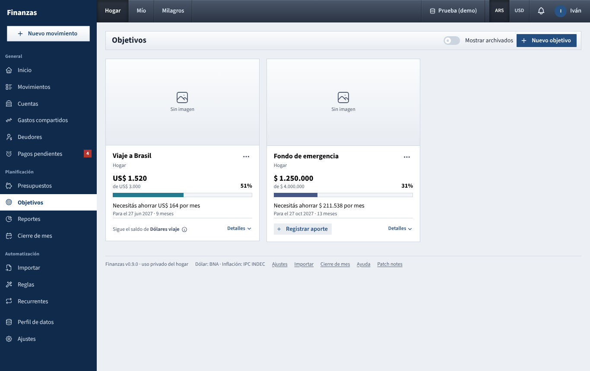

# Objetivos

Track savings toward something you want (an emergency fund, a trip, a bike, a future car) and see how much you need to put aside each month to get there on time. Each objective can carry a picture, a link (for example the product page), short notes and a priority. This page used to be called *Metas de ahorro*; it is still at `/metas`.

## What you see

One card per objective, ordered by deadline (soonest first, objectives without a deadline last). Each card shows:

- the **picture** across the top, cropped to the same shape on every card (a grey *Sin imagen* box when there is none), with a small **Prioridad alta / media / baja** tag and **Archivado** if it is archived;
- the **name**, then **Hogar** or **Personal** and, when the objective has a link, **Ver enlace** (opens in a new tab);
- the amount **saved** in large type, *de* the **target** below it and the percentage on the right, then the progress bar;
- a line under the bar:
  - **Objetivo cumplido.** once the saved amount reaches the target;
  - **Necesitás ahorrar $ X por mes** when there is a deadline;
  - **Faltan $ X** when there is no deadline;
- **Para el** *date* and how many months are left, when there is a deadline;
- at the bottom, how progress is measured (see below):
  - **Sigue el saldo de** *account* on objectives linked to an account. Hover or tap it for the explanation;
  - a **Registrar aporte** button on objectives with manual contributions (just *Aportes manuales* on your partner's, which are read only);
- **Detalles**, which opens the notes, a sentence on how progress is measured and, on manual objectives, **Ver historial de aportes**. Click it again to close.

The page shows the household objectives, your own and, if your partner shares their dashboard, their personal ones (read only, without the **⋯** menu). It does not filter by the dashboard chosen in the top bar. The pictures follow the same rule: nobody can open the picture of an objective they cannot see.

Archived objectives are hidden. Turn on **Mostrar archivados** to see them, faded.

## What you can do

### Create an objective

1. Click **Nuevo objetivo**.
2. Fill in:
   - **Nombre**, for example *Fondo de emergencia*;
   - **Monto objetivo** (the target) and **Moneda** (ARS or USD);
   - **Fecha límite** (optional, today or later) and **Prioridad** (optional: **Alta**, **Media** or **Baja**);
   - **Cuenta vinculada** (optional, see below);
   - **Imagen** (optional): **Elegir imagen** picks a JPG, PNG or WEBP photo. Large photos are shrunk before upload; the card crops it to its fixed shape;
   - **Enlace** (optional): a full web address starting with `http://` or `https://`, for example the product page;
   - **Notas** (optional, up to 500 characters): they only show under **Detalles**;
   - **Ámbito**: **Hogar (de los dos)** or **Mío**. It starts on **Mío** if you are viewing your own dashboard, otherwise on **Hogar**;
   - **Color** for the progress bar.
3. Click **Guardar**.

### Choose how progress is measured

There are two ways, and each objective uses one. This is why some cards have **Registrar aporte** and others do not:

- **Linked account**: pick an account in **Cuenta vinculada**. The saved amount is that account's current balance: whatever is in the account counts as contributed. Every deposit or withdrawal you record in that account moves the objective, so there is nothing to register on the card; it shows **Sigue el saldo de** *account* instead. This works best with an account used only for this purpose, such as a savings account for the trip.
- **Manual contributions**: leave **Cuenta vinculada** empty (*Sin vincular (aportes manuales)*). The saved amount is the sum of the contributions you record with **Registrar aporte**.

### Record a contribution (manual objectives)

1. Click **Registrar aporte** on the card, or **⋯ → Aportes**.
2. Enter the **Fecha**, the **Monto** and an optional **Nota**. Use a negative amount for a withdrawal.
3. Click **Registrar aporte**. The list below shows every contribution (green) and withdrawal (red).
4. Use the trash icon on a row to delete it.

Contributions are a record for the objective only. They do not create a movement and do not change any account balance. If you also moved real money, record that movement in [Movimientos](movimientos.md) as usual.

### Edit, archive or delete

- **⋯ → Editar** opens the same form. Change anything, including the linked account. Under **Imagen**, **Reemplazar** picks a new picture and **Quitar** removes it; nothing changes until you click **Guardar**. Empty the **Enlace** or **Notas** field to remove them.
- To archive an objective (finished or put on hold), open **⋯ → Editar**, turn on **Archivado** and save. Turn it off the same way to bring it back.
- **⋯ → Eliminar** deletes the objective, its picture and all its recorded contributions. Linked accounts and their movements are not touched.

You can edit household objectives and your own. Your partner's personal objectives are read only.

## How the numbers are worked out

- **Saved, linked account**: the account's balance today (confirmed movements up to today; future installments do not count yet). If the account is in another currency than the objective, it is converted at today's BNA quote.
- **Saved, manual**: all contributions added up, withdrawals subtracted.
- **Avance** = saved ÷ target × 100, capped at 100%.
- **Months left** = the months from the current month to the deadline's month, counting both. In October with a deadline in March that is 6 (October to March). A deadline this month, or one already past, counts as 1.
- **Necesitás ahorrar por mes** = (target − saved) ÷ months left, rounded up to the cent. It is recalculated every time you open the page, so if you fall behind, the monthly amount goes up.

For example: target $ 3.000.000, saved $ 1.200.000, 6 months left: $ 1.800.000 ÷ 6 = $ 300.000 per month.

## Tips

- An objective is not archived automatically when it is reached. It shows **Objetivo cumplido.** and stays until you archive it.
- If you switch a manual objective to a linked account, its contributions are kept but no longer counted. Unlinking the account brings them back.
- Pictures are stored on the server in the `goals` folder of the data directory, next to the receipts.
- Changing a manual objective's **Moneda** does not convert the contributions already recorded; their numbers are simply read in the new currency.
- Inflation is not applied to targets. For a long objective in pesos, consider setting it in dollars or updating the target from time to time.

See also: [Guide index](README.md) · [Cuentas](cuentas.md) · [Movimientos](movimientos.md) · [Presupuestos](presupuestos.md) · [Reportes](reportes.md) · [How the numbers are worked out](como-se-calcula.md)
