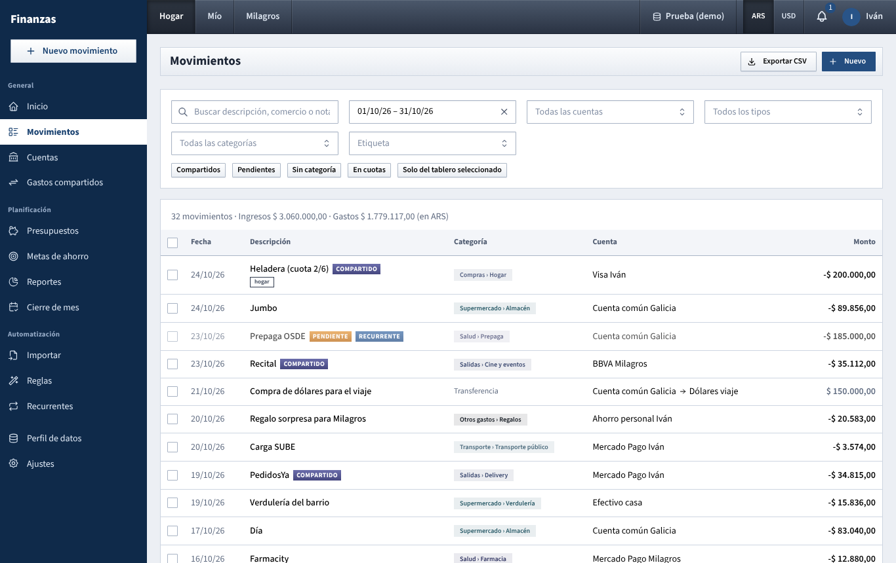
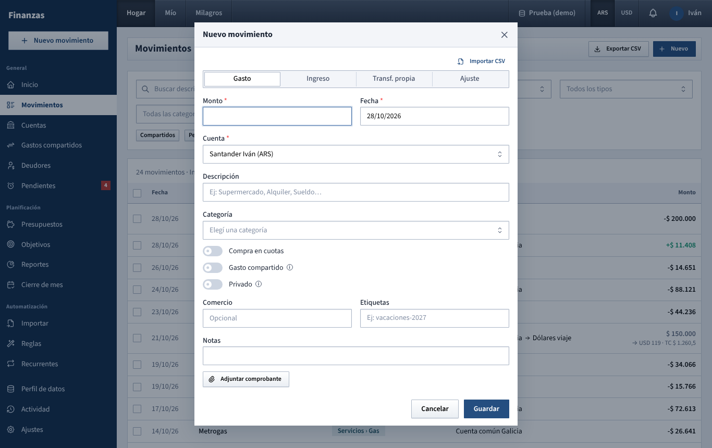

# Movimientos

The full list of everything you've recorded (spending, income, transfers and adjustments), with filters, plus the **Nuevo movimiento** form you use to add or change a movement.

## What you see

### Header

- **Exportar CSV**: downloads the movements in the date range you have selected (see [Exporting](#export-to-csv)).
- **Nuevo**: opens the **Nuevo movimiento** form. If the list is filtered to one account, that account is already chosen in the form.

### Filters

The filter card has two rows of boxes and a row of toggle buttons. All filters combine (a movement must match every one that is set).

| Filter | What it does |
| --- | --- |
| **Buscar descripción, comercio o nota** | Finds movements whose description, merchant or notes contain the text. Upper and lower case don't matter. |
| Date range | Starts on the current month. Click the **×** to clear it and see every date. A single day also works. |
| **Todas las cuentas** | Shows one account only. Transfers appear whether the account is the origin or the destination. Archived accounts are listed here too. |
| **Todos los tipos** | **Gastos**, **Ingresos**, **Transf. propias** (between your own accounts) or **Ajustes**. |
| **Todas las categorías** | Picking a main category also shows its subcategories. The list offers expense categories; choose **Ingresos** as the type first to get income categories. |
| **Etiqueta** | Movements carrying that tag. |

Toggle buttons (click to turn on, click again to turn off):

- **Compartidos**: only shared expenses and shared income.
- **Pendientes**: only pending movements (recurring items waiting for confirmation).
- **Sin categoría**: expenses and income with no category. Transfers and adjustments never have one, so they don't appear.
- **En cuotas**: only installments (from a **Compra en cuotas** or a **Cobro en cuotas**).
- **Tablero: Hogar** / **Tablero: Iván** / **Tablero: Milagros** (on by default; the name follows the tab in the top bar): the dashboard tabs pick whose movements you see. **Hogar** shows the **Compartido** ones; a person's tab shows theirs. While it's on, the Compartido / name tag is hidden, since the whole list is one group. Turn it off to see everything you're allowed to see, with the tags.

Coming from **Cuentas → Ver movimientos** opens this page already filtered to that account.

### Summary line

Above the table: **N movimientos · Ingresos $ … · Gastos $ … (en ARS)**.

- **N movimientos** counts every row that matches the filters, on all pages.
- **Ingresos** and **Gastos** add up only confirmed movements recorded in pesos. Pending movements, transfers, adjustments and movements in USD accounts are left out (USD amounts are not converted here).
- Shared movements are added at their full amount.

### The table

Newest first, 50 rows per page, with page numbers at the bottom when there are more.

| Column | Shows |
| --- | --- |
| Checkbox | Selects the row for [bulk actions](#change-or-delete-many-at-once). The box in the header selects every row on this page that you can edit. |
| **Fecha** | Day, as DD/MM/YY. |
| **Descripción** | The description (or the merchant if there's no description, or **(sin descripción)**), followed by labels: **Pendiente**; whose it is (**Compartido**, or the person's name, see below); **Privado**; **Recurrente**; and a paperclip if a receipt is attached. Tags appear underneath. |
| **Categoría** | For expenses and income, the category as **Main › Sub**. Otherwise **Transferencia**, **Pago de deuda** (a settlement between you two) or **Ajuste**. |
| **Cuenta** | The account. Transfers show **origin → destination**. **Cuenta privada** means the account belongs to your partner and is private: you see the movement only because it's a shared expense or a payment to you. |
| **Monto** | In the account's own currency (`$` or `US$`). Expenses carry a minus sign, income a plus sign in green, transfers no sign in grey (the amount that left the origin), adjustments their own sign. |

**Whose a movement is.** Every movement carries one tag:

- **Compartido**: marked as a shared expense or income, or made in a joint account. Hover it to see who paid (or received it), or *Cuenta común*.
- **Iván** / **Milagros**: made in that person's own account and not shared.

Pending rows are shown faded. Click any row to open it in the form.

## What you can do

### Add a movement

Open the form from any of these:

- **Nuevo movimiento** at the top of the sidebar (available on every page).
- **Nuevo** on this page.
- **Movimiento** on an account card in **Cuentas** (that account comes preselected).
- **Agregar** next to **Últimos movimientos** on **Inicio**.
- **Agregar gasto compartido** on **Gastos compartidos**.

The form is described below in [The Nuevo movimiento form](#the-nuevo-movimiento-form).

### Find something

1. Clear the date range if the movement may be older than this month.
2. Type part of the description, merchant or notes in the search box.
3. Narrow further with account, type, category, tag or the toggle buttons.

### Change or delete many at once

1. Tick the rows (or use the header checkbox for the whole page). Rows you can't edit can't be ticked.
2. Click the **N seleccionados** button that appears above the table.
3. Choose:
   - **Asignar categoría**: pick a category and click **Aplicar**. It's only applied to movements of the same kind as the category (an expense category to expenses, an income category to income); the rest are skipped. If you click **Aplicar** without picking a category, the selected movements lose their category.
   - **Eliminar**: deletes them after a confirmation. This can't be undone. Deleting one installment this way deletes only that installment, not the whole purchase.

A message tells you how many movements changed.

### Export to CSV

**Exportar CSV** downloads `movimientos.csv` with every movement you can see in the selected date range (clear the range to export everything). The other filters are not applied to the file. The file uses `;` as separator so it opens directly in Excel set to Spanish, and includes type, status (**Pendiente** or **Confirmado**), description, merchant, category, account, destination account, currency, amount (negative for expenses and for the origin side of transfers), amount received, shared flag and split, installment number, tags and notes. Accounts you can't see appear as **(privada)**.

A full Excel workbook is in **Ajustes → Datos**: see [Ajustes](ajustes.md).

### Confirm a pending movement

Recurring bills and salaries arrive as **Pendiente** on their due date and don't count anywhere (totals, budgets, balances, who owes whom) until confirmed. See [Recurrentes](recurrentes.md).

1. Turn on **Pendientes** to see them, then click one.
2. A yellow notice reads "Movimiento recurrente pendiente…".
3. Correct the **Monto** and **Fecha** if the real bill was different.
4. Click **Confirmar** (it replaces **Guardar** for pending movements).

Only the amount and date you enter are applied when confirming; the other fields keep what the recurring item had. To change the category, description or anything else, confirm first, then open the movement again and edit it. If the item was shared with exact amounts and you change the total, the parts are rescaled in the same proportions.

### Edit or delete one movement

Click the row. The form opens as **Editar movimiento** with the stored values.

- The type (**Gasto**, **Ingreso**…) can't be changed once saved. Delete and re-create it instead.
- **Guardar** saves your changes.
- **Eliminar** (bottom left, in red) deletes it after "¿Seguro? Esta acción no se puede deshacer." Its receipt is deleted too.
- For an installment, a blue notice says "Cuota X de una compra en cuotas. Los cambios afectan solo a esta cuota." **Eliminar** removes only this installment; **Eliminar todas las cuotas** removes the whole purchase, past and future installments.
- If a grey notice says "Este movimiento está en una cuenta privada o de solo lectura.", you can look but not save. This happens with shared expenses your partner paid from a private account.

You can edit your partner's movements as long as they're in a joint account or in one of their accounts that isn't private.

## The Nuevo movimiento form

Fields marked with a red asterisk are required. Which fields appear depends on the type.

### Common fields

1. **Type** (the four tabs at the top): **Gasto**, **Ingreso**, **Transf. propia** (between your own or the household's accounts, not a payment to someone else), **Ajuste**.
2. **Monto**: in the currency of the chosen account (the prefix switches between `$` and `US$`). Use a comma for decimals.
3. **Fecha**: today by default.
4. **Cuenta**: the account the money left or entered. The list is grouped by **Común**, you and your partner, and shows the currency of each account. Click a group's title to open or close it: when the list opens, only the group of the selected account is open; typing searches all groups. Archived accounts aren't offered. A new form starts on your first personal account (or the first joint one if you have none).
5. **Descripción**: free text, for example "Supermercado". When you leave this box on a new expense or income, the app may fill in the category and more (see [Category suggestions](#category-suggestions)).
6. **Comercio**: optional merchant name. Used by [Reportes](reportes.md) for top merchants.
7. **Etiquetas**: type a tag and press Enter; existing tags are suggested. Up to 20 per movement.
8. **Notas**: free text. Notes are visible only to people who can see the account; on a shared expense paid from a private account, your partner sees the movement but not the notes.
9. **Adjuntar comprobante**: see [Receipts](#receipts).

Click **Guardar**. A confirmation message appears and the form closes.

### Gasto and Ingreso

- **Categoría**: expense categories for **Gasto**, income categories for **Ingreso**. Optional; uncategorised movements can be found later with **Sin categoría**.
- **Gasto compartido** / **Ingreso compartido** and **Privado**: see below.
- **Compra en cuotas** / **Cobro en cuotas** (new expenses and income only): see below.

### Transferencia

Money moving between two accounts. It never counts as income or spending.

- **Desde** and **Hacia**: origin and destination. They must be different accounts.
- **Monto**: what left the origin account.
- There's no category, shared switch or private switch.
- A transfer into a joint account is a contribution to the household pot. It doesn't create a debt between you.

**Buying dollars (two currencies).** When **Desde** and **Hacia** are in different currencies, a new box appears: **Monto recibido en USD** (or **en ARS**), "Ej: compra de dólares: cuántos dólares entraron." Enter the pesos that left in **Monto** and the dollars that arrived here. The origin balance goes down by the first amount and the destination goes up by the second, so the effective rate is whatever you actually paid.

**Paying each other back.** When **Desde** is one partner's personal account and **Hacia** is the other partner's personal account, a checkbox appears: **Es un pago para saldar deudas entre nosotros**, ticked by default. While ticked, the transfer reduces what one owes the other in [Gastos compartidos](gastos-compartidos.md) and shows as **Pago de deuda** in the list. Untick it for a transfer between you that has nothing to do with shared expenses (a gift, a loan you track separately). A settlement must be in one currency: both accounts need the same currency, or you must untick the box.

The quickest way to settle up is the **Saldar** button in [Gastos compartidos](gastos-compartidos.md), which fills this in for you.

### Ajuste

Corrects an account balance without counting as income or spending, for example when the bank balance and the app don't match.

- **Monto** can be negative: "Negativo para restar del saldo". Zero isn't allowed.
- No category and no shared switch. On a personal account it can be private.

See [Cuentas](cuentas.md) for when to use an adjustment versus changing the opening balance.

### Shared expense and shared income

Turn on **Gasto compartido** (for an expense) or **Ingreso compartido** (for income). Hover the (i) icon for a short explanation.

- **Gasto compartido**: "Se divide entre ustedes y suma a lo que uno le debe al otro (si se pagó con una cuenta personal)."
- **Ingreso compartido**: "Es de los dos: se reparte y, si entró a una cuenta personal, quien lo recibió le debe su parte al otro." Useful for things like a refund or rent collected for both of you.

A **División** selector appears:

| Option | How the amount is split |
| --- | --- |
| **Cincuenta-cincuenta** | Shown when the household default is equal parts. Half each. |
| **Por defecto (Iván 60% / Milagros 40%)** | Shown instead when the household default isn't equal; it uses the percentages set in **Ajustes → Hogar**. |
| **Partes iguales** | Equal parts. Only offered when the default isn't already equal. |
| **Porcentajes** | A percentage box per person, starting at equal parts. Typing one fills the other with the rest. |
| **Montos exactos** | An amount box per person, starting at half of the current total each. Typing one fills the other with the rest. |

The parts must add up. If they don't, a red message explains by how much, for example "Los porcentajes tienen que sumar 100% (ahora suman 90%)." or "Los montos tienen que sumar el total: faltan $ 500,00." If you change **Monto** after choosing exact amounts, check the boxes again: they don't follow the new total.

When the account is a joint one, a note says "Pagado con una cuenta común: se reparte en los totales personales pero no genera deuda." (or "Entró a una cuenta común…" for income). The split still decides how much appears in each person's **Mío** dashboard.

In **Hogar** a shared movement counts at its full amount; in **Mío** only your part counts. How debts arise is explained in [Gastos compartidos](gastos-compartidos.md), and the rounding rules in [How the numbers are worked out](como-se-calcula.md).

Shared movements can't be private.

### Private

**Privado**: "Tu pareja no verá este movimiento." It appears only for expenses, income and adjustments in a personal account, and disappears while the shared switch is on. A private movement is left out of everything your partner sees: the list, dashboards, reports and exports.

If the whole account should be hidden, make the account private instead: see [Cuentas](cuentas.md).

### Compra en cuotas (installments)

For a card purchase paid in monthly installments. Available on a new **Gasto**. (For income, see **Cobro en cuotas** below.)

1. Turn on **Compra en cuotas**. **Monto** becomes **Monto total de la compra** and **Fecha** becomes **Fecha de compra**.
2. Enter the total and the purchase date.
3. **Cantidad de cuotas**: from 2 to 72.
4. **Primera cuota**: "Mes en que llega el primer resumen", the date of the first installment.
5. A line shows the result, for example "6 cuotas de $ 200.000,00".
6. Fill in category, shared, tags and the rest as usual, then **Guardar**. The message reads "Compra en 6 cuotas registrada".

What gets created:

- One expense per installment, one month apart, on the same day of the month as **Primera cuota** (moved to the last day in shorter months).
- Each one is named after the description plus "(cuota 1/6)", "(cuota 2/6)"… An empty description becomes "Compra en cuotas".
- The total is divided evenly; any leftover cents go to the first installments, so they add up exactly.
- Category, tags, shared split and private flag are copied to every installment. A split with exact amounts is turned into the same proportions for each installment.
- Installments dated in the future don't change account balances or who owes whom until their date arrives, but they show as committed spending on [Inicio](inicio.md).

### Cobro en cuotas (income in installments)

For something you sold or charged to be paid in monthly installments: it's money to collect, not money you have yet. Available on a new **Ingreso**.

1. Turn on **Cobro en cuotas**. **Monto** becomes **Monto total a cobrar** and **Fecha** becomes **Fecha de venta**.
2. **Cantidad de cuotas** and **Primer cobro** (the others fall on the same day of each following month).
3. **Guardar**. The message reads "Cobro en 3 cuotas registrado: confirmá cada cuota cuando la cobres".

Each cuota is created **pending**: it doesn't count in balances, totals or reports. When its date arrives it shows up in the yellow alert on **Inicio** and **Recurrentes** (*Hay 1 movimiento vencido para confirmar*). Click **Revisar**, check the amount you actually received and click **Confirmar**; from then on it counts like any income. If a cuota wasn't paid, leave it pending until it is.

### Importar CSV (several at once)

At the top of a new movement, **Importar CSV** opens a window to load many movements from one file.

1. Click **Descargar ejemplo** to get a sample file with the right columns, and fill it in a spreadsheet (one row per movement).
   - Required: **fecha** (DD/MM/AAAA or AAAA-MM-DD), **tipo** (gasto or ingreso), **monto** (positive, comma for decimals, e.g. 12.500,50), **cuenta** (the account's name exactly as in **Cuentas**).
   - Optional: **categoria** (a category, or *Main > Sub*), **descripcion**, **comercio**, **compartido** (si/no), **etiquetas** (separated by |), **notas**.
2. Click **Elegir archivo** and pick the CSV (an .xlsx with the same columns also works).
3. The window lists every row with its status: **OK**, **ERROR** (with the reason, e.g. *No hay una cuenta llamada «X»*) or **REPETIDO** (a movement with the same account, date, amount and description already exists, so it's skipped).
4. Click **Cargar N movimientos** to save the OK rows. Fix any errors in the file and pick it again to load the rest.

For bank statements with their own layout, use [Importar](importar.md) instead, which remembers a setup per bank.

Find them later with the **En cuotas** filter.

### Category suggestions

On a new expense or income, when you leave the **Descripción** box:

1. If a [rule](reglas.md) matches the description, it fills in the category, merchant and tags (only those you left empty) and can turn the shared switch on or off. A grey line under **Categoría** reads "Regla aplicada: <rule name>".
2. Otherwise, if an earlier movement had exactly the same description (ignoring case) and a category, that category and merchant are suggested: "Categoría sugerida según movimientos anteriores".

Suggestions never replace a category you already chose, and you can change anything before saving. They don't run when editing.

### Receipts

**Adjuntar comprobante** accepts a photo (JPG, PNG, WEBP) or a PDF, up to 3 MB. Large photos are shrunk in your browser before uploading (to about 1600 px on the longest side), so they usually end up around 150 to 300 KB. The file is uploaded when you click **Guardar**.

On a movement that has one, the button reads **Reemplazar comprobante**, and two links appear: **Ver comprobante** (opens it in a new tab) and **Quitar** (removes it straight away, without asking). In the list, a paperclip marks movements with a receipt.

### When something is wrong

If a field is missing or invalid, it's outlined in red and a red message appears in the corner. Common ones:

| Message | Fix |
| --- | --- |
| "Ingresá el monto." | Enter an amount above zero (or any non-zero amount for an **Ajuste**). |
| "Elegí una cuenta." / "Elegí la cuenta destino." | Pick the account(s). |
| "Indicá cuánto entró en USD." | Fill in **Monto recibido** for a transfer between currencies. |
| "La cuenta destino debe ser distinta a la de origen." | **Desde** and **Hacia** are the same account. |
| "La categoría no corresponde al tipo de movimiento." | An income category on an expense (or the other way round), usually from a suggestion. Pick another one. |
| "Para saldar deudas, ambas cuentas deben tener la misma moneda." | Untick **Es un pago para saldar deudas entre nosotros**, or use accounts in the same currency. |
| "No podés modificar movimientos de una cuenta privada de tu pareja." | Only the owner can change those. |
| Split messages | See [Shared expense and shared income](#shared-expense-and-shared-income). |

## Tips

- Turn off **Tablero: …** to see everyone's movements together.
- To review last month's uncategorised spending: set the date range, turn on **Sin categoría**, tick the rows and use **Asignar categoría**. A [rule](reglas.md) saves doing it again next month.
- For a **Compra en cuotas**, attach the receipt afterwards: open one of the installments and use **Adjuntar comprobante** there.
- Buying dollars is a **Transf. propia**, not a **Gasto**: that way it doesn't inflate your spending and the dollars appear in the USD account.

See also: [Guide index](README.md) · [Inicio](inicio.md) · [Cuentas](cuentas.md) · [Gastos compartidos](gastos-compartidos.md) · [Recurrentes](recurrentes.md) · [Reglas](reglas.md) · [Importar](importar.md) · [How the numbers are worked out](como-se-calcula.md) · [Login and top bar](barra-superior.md)
