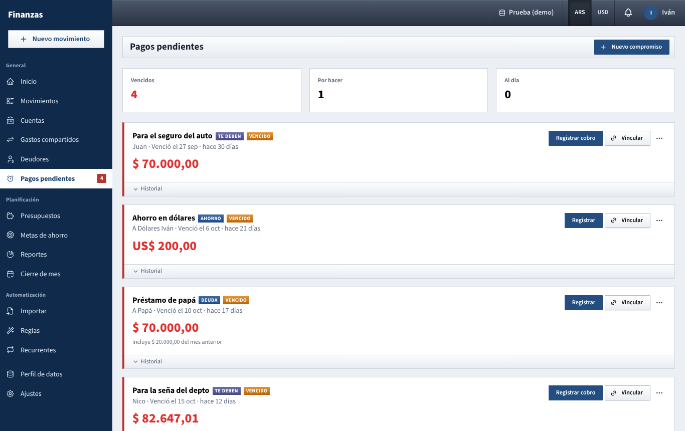

# Pagos pendientes

The things you have to do yourself every month, and the money people owe you on a schedule, with the app chasing you until each one is done.

Pagos pendientes sits next to [Recurrentes](recurrentes.md) and doesn't replace it:

- **Recurrentes**: things that arrive by themselves, where you only confirm the real amount. Bills, subscriptions, salary, card installments, purchases.
- **Pagos pendientes**: commitments you carry out yourself, with people or with yourself. A monthly savings transfer, a debt you're paying back, money someone owes you.

Each person only sees, and is only chased for, what they are responsible for.

## What you see

- **Pagos pendientes** in the sidebar, with a red counter of what's due today or late.
- Three figures: **Vencidos**, **Por hacer** and **Al día**.
- One card per item, the late ones first, with a red rule on the left:
  - the name and two tags: **AHORRO** (savings), **DEUDA** (you pay someone) or **TE DEBEN** (someone pays you), plus **VENCIDO**, **PARCIAL**, **PENDIENTE** or **AL DÍA**;
  - where it goes or who it's with, and when it was due (*Venció el 6 oct · hace 21 días*);
  - the amount still missing, large; below it what was already paid and *incluye $ X del mes anterior* when something rolled over;
  - **Registrar**, **Vincular** and the **⋯** menu;
  - **Historial**: every month with what was expected and paid, the payments, and the reason for any partial one.

## What you can do

### Create a commitment

1. Click **Nuevo compromiso**.
2. **Ahorro mensual** or **Deuda que pago**.
3. **Nombre** (e.g. *Ahorro en dólares*) and, for a debt, **¿A quién?**
4. **Cada mes**: the amount and its currency.
5. **Cuenta de ahorro (destino)** for savings; for a debt, optionally **Pagás desde**.
6. **Día** of the month it's due, **Desde** (first month) and **Meses** (empty for no end; e.g. 6 for a debt in 6 payments).

Loans from [Deudores](deudores.md) with a return date or installments appear here on their own as **TE DEBEN**.

### Mark it as done

- **Registrar** opens **Nuevo movimiento** already filled in: a **Transf. propia** to the savings account, a payment to that person, or the money that came back. Save it and the item updates.
  - For a dollar target when you have no other dollar account to pay from, the form fills the **US$** to receive: type the pesos you paid and the rate is calculated. That's the conversion; only dollars count for a dollar target.
- **Vincular** lists movements of the last 90 days in the same currency, exact amounts first (**EXACTO**). Pick one and click **Vincular**.

You often don't need either: **a movement with exactly the amount** (what's missing, or the monthly amount) is **linked automatically** when you save it, import it or load it from a CSV.

### Partial payments

If what you pay is less than what's missing, the app asks **¿Por qué es parcial?** and doesn't save without an answer. The rest **rolls over** to the next month: with a monthly $ 50.000 and $ 30.000 paid in September, October expects $ 70.000. Paying more works the other way: the extra lowers the next month.

To undo a link, open **Historial**, use the **⋯** of that month and **Desvincular**.

### Edit or delete

**⋯ → Editar** or **Eliminar** (deleting keeps the movements). For loans, **⋯ → Ver en Deudores**.

## How the reminders work

From the due day until it's done, the person responsible gets a reminder **every day, including weekends, between 8 and 18**, three times a day (around 8, 12 and 16): in the bell and by email (see [Set up email notifications](configurar-correo.md)). These reminders can't be turned off: they stop when the item is done.

## Tips

- For savings, create a separate account for it in [Cuentas](cuentas.md) and point the commitment there.
- The exact amount is what triggers the automatic link: transfer the round figure (e.g. exactly US$ 200).

See also: [Guide index](README.md) · [Deudores](deudores.md) · [Recurrentes](recurrentes.md) · [Movimientos](movimientos.md) · [Ajustes](ajustes.md)
