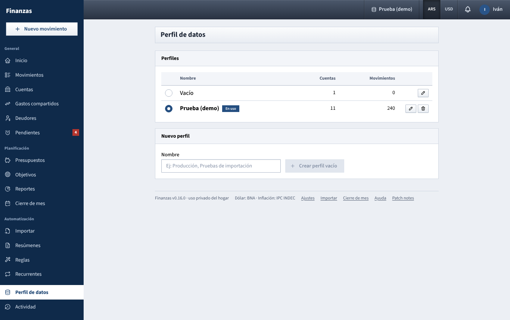

# Perfil de datos

Keep separate sets of data (for example your real finances, the demo, or a test of a new bank import) that never mix, all used with the same two logins.

## What a profile is

A profile is a complete, independent copy of the household's finances. Each one has its own:

- accounts, movements, receipts attached to movements, installments and recurring items;
- categories (a new profile starts with the default list), budgets, savings goals, rules and import presets;
- household settings from **Ajustes → Hogar**: household name, default split, which BNA quote to use, budget alert levels and automatic indexing;
- exchange rates and CPI (**Ajustes → Cotizaciones e inflación**), including any you entered by hand;
- notifications in the bell and monthly reviews (**Cierre de mes**) with their notes;
- daily backup.

What is the same in every profile:

- the people: usernames, passwords, display names and colors;
- each person's choices in **Ajustes → Perfil** and **Ajustes → Notificaciones**: sharing the personal dashboard, the linked Telegram chat and which alerts to receive.

So you log in once, and switching profile changes every figure on screen but not who you are.

## What you see

The page has two boxes.

**Perfiles**: a table with one row per profile.

- First column (no title): a round button, filled for the profile you are using.
- **Nombre**: the profile's name. The one in use is in bold with an **En uso** label.
- **Cuentas** and **Movimientos**: how many accounts and movements it holds, so you can tell an empty profile from a full one.
- On the right, a pencil button (rename) and, except on the default profile, a bin button (delete).

**Nuevo perfil**: a **Nombre** field (placeholder *Ej: Producción, Pruebas de importación*) and the **Crear perfil vacío** button.

The profile in use is also shown in the top bar, next to the **ARS / USD** switch (see [Login and top bar](barra-superior.md)).

## The profiles you start with

- **Vacío**: created automatically on a new installation, the default one and empty (default categories only). It can be renamed but never deleted. It is what the app opens on until you pick something else.
- **Prueba (demo)**: only exists if the app was started with demo data. It holds about five months of made-up movements for Iván and Milagros. Its exchange rates and CPI are synthetic and marked `demo` in the **Fuente** column; **Actualizar desde BNA** and **Actualizar IPC** in **Ajustes → Cotizaciones e inflación** replace them with real ones (the app also does it by itself when it can reach the internet).
- **Principal**: only on installations that existed before profiles were added. It holds the data you had then. Those installations also get an empty **Vacío** as the default, so pick **Principal** once in each browser.

## What you can do

### Switch to another profile

1. Click the round button in the first column of the profile you want. (Or use the profile menu in the top bar.)
2. You stay on the page you're on; everything it shows is reloaded from the new profile, and *Perfil «name» en uso* appears.

The choice is remembered **in this browser** for a year, even after **Cerrar sesión**. It is not shared between devices: if Iván switches to **Prueba (demo)** on his computer, Milagros keeps seeing whatever profile her browser had. A browser that never picked a profile (or a private window) opens on the default one.

### Create a profile

1. Type a name in **Nombre** under **Nuevo perfil**.
2. Click **Crear perfil vacío** (or press Enter).
3. The message *Perfil creado, vacío y listo para usar* confirms it. The new profile appears in the table but is **not** selected yet; switch to it when you want to use it.

A new profile has the default categories and default household settings, no accounts, no movements and no exchange rates. Rates and CPI are downloaded automatically within about 15 minutes; to have them at once, open **Ajustes → Cotizaciones e inflación** and click **Actualizar desde BNA** and **Actualizar IPC**.

### Rename a profile

1. Click the pencil next to it.
2. Change the **Nombre** and click **Guardar**.

Any profile can be renamed, including the default one. Names can be up to 60 characters.

### Delete a profile

1. Click the bin next to it.
2. The window **Borrar «name»** warns: *Se quitan sus N cuentas y M movimientos de la app; queda una copia en la carpeta de respaldos. Los usuarios no se tocan.*
3. Click **Borrar perfil**.

The profile leaves the app, but nothing is lost: a full copy of it is kept in the data folder, under `backups/guardados/` (for example `perfil-3-borrado-20261029-213146.sqlite`), and the backup rotation never removes those. There is no undo button; whoever runs the server can bring the copy back. The default profile can't be deleted, and there must always be at least one profile. If you delete the profile you are using, the app moves you to the default one.

Any of you can create, rename and delete profiles; there is no owner per profile.

## Backups and profiles

- Every profile gets its own automatic daily backup, whether or not anyone opened it that day.
- **Crear copia ahora** in **Ajustes → Datos** backs up the profile **in use**.
- The logins and the list of profiles are backed up once a day in a separate file.
- The backup list in **Ajustes → Datos** shows the files of all profiles together. File names start with `perfil-` and the profile's number, `core-` for logins, or `finanzas-` for the original **Principal** profile.

See [Ajustes](ajustes.md#datos) for how long backups are kept.

## Things that happen in every profile

The automatic tasks run for each profile separately: recurring items become pending on their due date, rates and CPI are refreshed, budgets are indexed if that profile has it turned on, and in the first three days of a month last month's review is sent. This means a profile with movements in the past month (such as the demo) can also send its monthly review by Telegram. If that's not what you want, delete profiles you no longer use.

## Tips

- Use a separate profile to try a new import preset or a batch of rules on real statements, then delete it, without touching your real data.
- Before your first real entry, rename **Vacío** to something like *Nuestras finanzas* so it's obvious in the top bar.
- If the numbers look wrong or empty, check the profile name in the top bar before anything else.

See also: [Guide index](README.md) · [Login and top bar](barra-superior.md) · [Ajustes](ajustes.md) · [Importar](importar.md) · [How the numbers are worked out](como-se-calcula.md)
