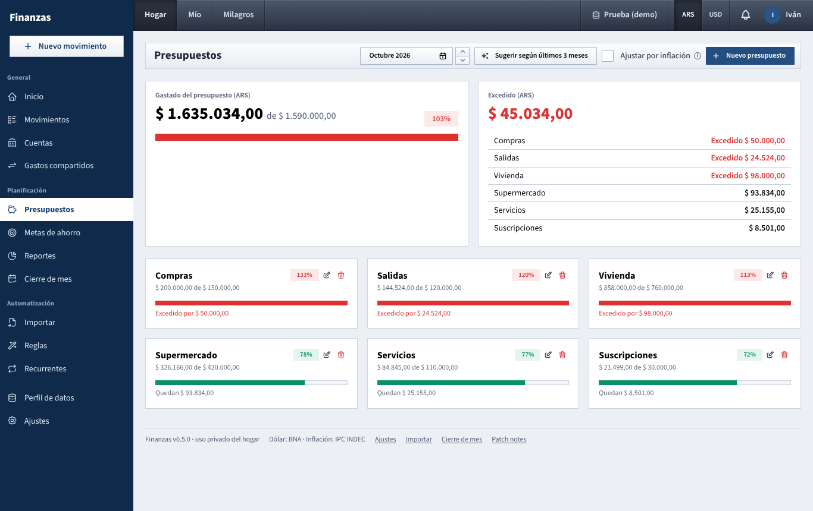

# Presupuestos

Set a monthly spending limit per expense category and see how much of it you have used this month.

## What you see

The page follows the dashboard chosen in the top bar (**Hogar**, **Mío** or your partner's, see [Guide index](README.md)). The subtitle reminds you which one: *Límites mensuales por categoría · Hogar*.

- **Month selector** (top right): pick any month. Budgets are the same every month; only the spending changes.
- **Gastado del presupuesto (ARS)**: total spent against all budgets in pesos, "de" the sum of those budgets, with a percentage badge and a bar. Budgets in dollars are not part of this total.
  - In the current month a line below adds how far through the month you are and what is left per day, for example *Pasó el 77% del mes. Quedan $ 120.000 para 8 días ($ 15.000 por día).*
- **One card per budget**, sorted from most used to least used:
  - category name, *spent de budget*, a percentage badge and a bar;
  - **Quedan $ X** (with **$ Y por día** in the current month) or, in red, **Excedido por $ X**;
  - **vas más rápido que el mes** when you are more than 10 points ahead of the share of the month that has passed (and not yet at 100%).
- **Colors**: green below 80%, yellow from 80%, red from 100%. These color steps are fixed and do not follow the alert settings.
- **Gastos sin presupuesto este mes**: main categories with spending this month that no budget covers, with a **Presupuestar** button next to each.

When you look at your partner's dashboard, a grey note says *Estás viendo los presupuestos de tu pareja. Solo podés editar los del hogar y los tuyos.* and the buttons are hidden.

## What you can do

### Create a budget

1. Choose **Hogar** or **Mío** in the top bar. That decides whether the budget is for the household or only for you.
2. Click **Nuevo presupuesto**.
3. Pick the **Categoría** (only expense categories). A budget on a main category also covers its subcategories.
4. Enter the **Monto mensual** and the **Moneda** (ARS or USD).
5. Click **Guardar**.

Each category can have one budget per dashboard. Saving a new budget for a category that already has one replaces its amount.

### Start from what you actually spend

Click **Sugerir según últimos 3 meses**. The window lists each main category with the average monthly spending of the last three full months (the current month is not included), largest first.

- Categories without a budget come ticked; categories that already have one say *Ya tiene presupuesto (se reemplaza)* and come unticked.
- Adjust any amount, tick what you want and click **Guardar seleccionados**. Suggested budgets are always in pesos.

You can also click **Presupuestar** on a row of **Gastos sin presupuesto este mes**. The form opens with that category and this month's spending as the amount.

### Edit or delete

Use the pencil icon on a card to change the amount or currency (the category cannot be changed; delete and recreate instead). Use the trash icon to delete it. Deleting a budget does not touch any movement.

### Adjust for inflation

Click **Ajustar por inflación** and confirm. Every peso budget of the dashboard you are viewing goes up by the latest monthly CPI that has been loaded. A message tells you the percentage, which CPI month was used and how many budgets changed. Dollar budgets stay as they are.

To do this automatically, turn on **Actualizar presupuestos por inflación automáticamente** in **Ajustes → Hogar**. Then, each time a new monthly CPI is published, all peso budgets of every dashboard (household and both personal ones) go up by it, and you get a notice *Presupuestos actualizados por inflación*. The first CPI after you turn it on is the first one applied; earlier ones are not.

More about CPI in [How the numbers are worked out](como-se-calcula.md).

### Alerts at 80% and 100%

When a movement makes a budget of the current month cross a threshold, you get a notice in the bell of the top bar and, if you linked Telegram, a Telegram message such as *Presupuesto al 80%: Supermercado* or *Presupuesto superado: Supermercado*.

- Household budget alerts go to both of you; personal budget alerts go only to that person.
- Each threshold is announced once per budget and month. If one movement jumps past both, you only get the higher one.
- Change the two thresholds in **Ajustes → Hogar** (**Primer aviso de presupuesto** and **Segundo aviso**).
- Turn Telegram delivery on or off in **Ajustes → Notificaciones** (**Presupuestos al 80% y superados**). The notice in the app is always kept.

## How the numbers are worked out

- **Spent** is the sum of confirmed expenses of that month in the chosen dashboard, in the budget's category or its subcategories. Pending recurring movements are not counted until you confirm them.
- What counts in each dashboard follows the usual rules: **Hogar** counts joint-account spending plus shared expenses at their full amount; **Mío** counts your own accounts plus only your share of shared expenses. See [Gastos compartidos](gastos-compartidos.md).
- Movements in the other currency are converted to the budget's currency at the BNA quote of each movement's own day.
- **Percentage** = spent ÷ budget × 100.
- **Per day** = what is left ÷ days left in the month, counting today.
- **Share of the month passed** = today's day number ÷ days in the month. "Vas más rápido que el mes" appears when the budget's percentage is more than 10 points above that.
- **Inflation adjustment**: new budget = budget × (1 + CPI of the latest month ÷ 100), rounded to whole pesos. With a CPI of 2,7%, a $ 100.000 budget becomes $ 102.700.
- **Suggestion**: for each main category, (spending in each of the last three months) added up and divided by 3, rounded to whole pesos.

## Tips

- There is nothing to copy from one month to the next: a budget keeps applying every month until you change or delete it.
- **Ajustar por inflación** applies the latest CPI each time you click it. Click it once per CPI publication, or leave it to the automatic option, but not both for the same month.
- Alerts are checked when you add, edit or confirm a movement in the app. Rows brought in with **Importar** do not trigger alerts by themselves.
- If a subcategory has its own budget and so does its parent, the subcategory's spending counts in both.

See also: [Guide index](README.md) · [Inicio](inicio.md) · [Movimientos](movimientos.md) · [Gastos compartidos](gastos-compartidos.md) · [Metas de ahorro](metas.md) · [Reportes](reportes.md) · [Cierre de mes](cierre-de-mes.md) · [Ajustes](ajustes.md) · [How the numbers are worked out](como-se-calcula.md)
