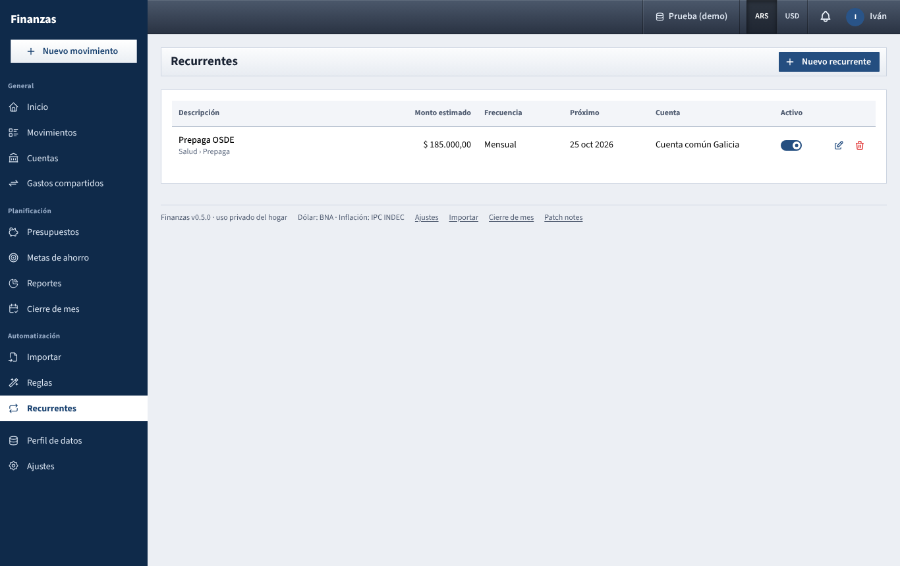
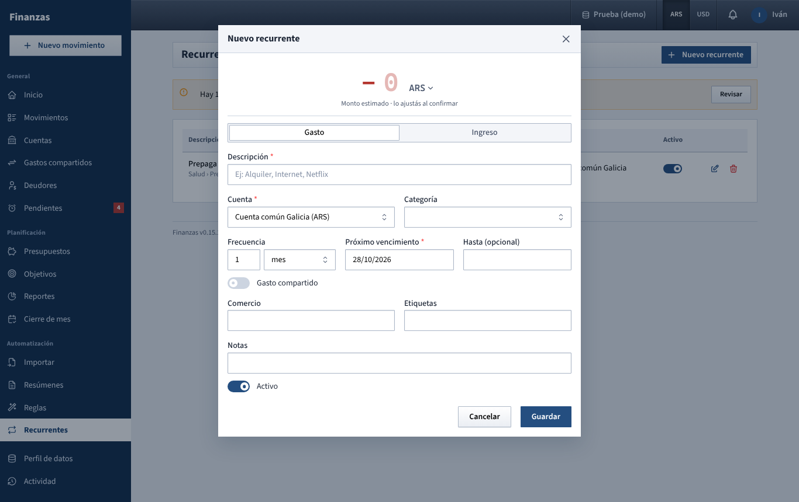

# Recurrentes

Set up bills and income that repeat (rent, services, subscriptions, salary) so the app reminds you on each due date and you only confirm the real amount.

## What you see

A recurring item is a **template**, not a movement. On each due date the app creates a **pending** movement from the template, with the estimated amount. A pending movement:

- appears in **Movimientos**, faded, but does **not** count in balances, totals, budgets or reports;
- waits until one of you confirms it with the real amount (bills change from month to month);
- triggers a notice *Para confirmar: Alquiler* in the bell of the top bar and, if you turned it on, by Telegram (**Ajustes → Notificaciones → Recurrentes pendientes de confirmar**). For a joint account the notice goes to both of you; for a personal account, only to its owner.

The app checks for due templates every 15 minutes and also right after you save one. If a template's next date is already in the past, it creates one pending movement for each missed date up to today.

On the page:

- **Yellow alert** at the top, only when something is waiting: *Hay 2 recurrentes vencidos para confirmar con el monto real.* with a **Revisar** button.
- **List of templates** with:
  - **Descripción**, the category below it, and badges **Compartido** and **Ingreso** where they apply;
  - **Monto estimado**;
  - **Frecuencia**: *Mensual*, *Semanal*, *Anual* or *Cada 2 meses* and so on;
  - **Próximo**: the next due date (or a dash when the template is paused), plus *hasta* *date* if it has an end date;
  - **Cuenta**;
  - **Activo** switch, and pencil and trash icons.

Active templates come first, ordered by next date. Paused ones are faded. Your partner's private templates are not shown.

## What you can do

### Confirm what is due

1. Click **Revisar** in the yellow alert. The **Para confirmar** window lists each pending movement with its date, category (or *Ingreso*), account and *compartido* if it is shared.
2. Type the real amount in the box (it starts with the estimate).
3. Click **Confirmar**. From now on it counts like any other movement.

The other two buttons on each row:

- the **pencil** opens the full movement, where you can also change the date, category or anything else, and then click **Confirmar** there;
- the **X** discards that one occurrence (*Se elimina «Internet» de este período. El recurrente sigue activo.*). Use it when a bill did not come this time.

When a shared movement split by exact amounts is confirmed with a different amount, the split is kept in the same proportions.

### Create a template

Click **Nuevo recurrente**.

1. **Amount**: type the estimate in the large number at the top (*Monto estimado · lo ajustás al confirmar*). It shows **−** in red for an expense and **+** in green for income.
2. **Currency**: click **ARS** or **USD** next to the amount. The **Cuenta** list then only shows accounts in that currency, and the app picks one for you (a joint account first, then one of yours) if the current one does not match.
3. Choose **Gasto** or **Ingreso**. Switching clears the category, since the lists are different.
4. **Descripción**, for example *Alquiler* or *Sueldo*.
5. **Cuenta** (only accounts you can write to) and **Categoría**.
6. **Frecuencia**: a number and a unit, for example *1 mes*, *2 semanas* or *1 año* (up to 24).
7. **Próximo vencimiento** (for an expense) or **Próximo cobro** (for income): the date of the next occurrence. For monthly and yearly templates its day of the month is kept: a bill on the 31st falls on the 30th in 30-day months and on the 28th or 29th in February, then back to the 31st.
8. **Hasta (opcional)**: the last date it can fall on. After that the template turns itself off.
9. **Gasto compartido** / **Ingreso compartido**: turn it on to split each occurrence between you two. Under **División** choose the household default, **Partes iguales**, **Porcentajes** or **Montos exactos**. With two people, typing one part fills in the other. See [gastos-compartidos.md](gastos-compartidos.md).
10. **Privado**: only for a personal account and when it is not shared. Your partner will not see the template or its movements.
11. Optional: **Comercio** (or **Quién paga** for income), **Etiquetas**, **Notas**.
12. **Activo** is on by default. Click **Guardar**.

If the next date is today or earlier, the first pending movement appears right away.

### Edit a template

Click the pencil. Changes apply to the next occurrences only. Movements already created, pending or confirmed, keep what they had.

### Pause and resume

Turn off **Activo** in the list (or in the form) to stop new occurrences. Pending ones already created stay in **Revisar**.

When you turn it back on, every date missed while it was paused is created as a pending movement at once. To skip them, open the template with the pencil, set **Próximo vencimiento** to the next date you want, turn on **Activo** and save, all in one go.

### Delete a template

Click the trash icon and confirm. The template and its **pending** movements are deleted. Movements already **confirmed** stay in your history.

## Tips

- Use a realistic estimate: it is what you see in the list and in the reminder, and the amount box starts with it.
- For a card subscription in dollars, choose **USD** at the top so the template goes to your dollar card or account.
- Pending movements wait as long as needed; nothing is confirmed automatically.

See also: [README.md](README.md), [movimientos.md](movimientos.md), [cuentas.md](cuentas.md), [gastos-compartidos.md](gastos-compartidos.md), [presupuestos.md](presupuestos.md), [barra-superior.md](barra-superior.md), [ajustes.md](ajustes.md)
