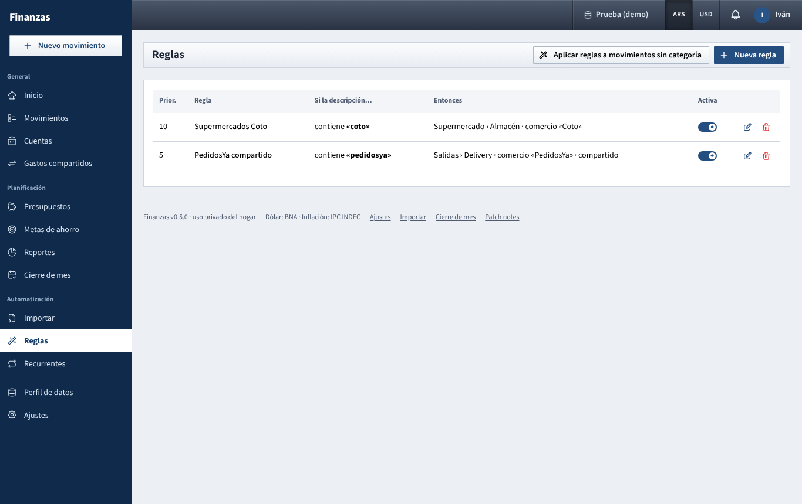

# Reglas

Teach the app to fill in category, merchant, shared flag and tags (or turn a row into a transfer) from the text of a movement's description.

## What you see

A table with one row per rule, highest priority first:

- **Prior.**: the priority number;
- **Regla**: its name;
- **Si la descripción…**: the condition, for example *contiene «COTO»*, plus *en* *account*, *desde* and *hasta* amounts below it when set;
- **Entonces**: what it does, for example *gasto · Supermercado · comercio «Coto» · compartido · #super*;
- **Activa** switch, and pencil and trash icons.

Inactive rules are faded and are ignored everywhere. Rules belong to the household: both of you see and use the same list.

## What you can do

### Create a rule

1. Click **Nueva regla**.
2. **Nombre** (optional; if empty, the search text is used), for example *Supermercado Coto*.
3. Under **Condición**:
   - **Si la descripción**: **contiene**, **empieza con**, **es igual a** or **coincide con la expresión**;
   - **Texto**: what to look for, for example *COTO*;
   - **Solo en la cuenta (opcional)**: limit the rule to one account;
   - **Monto desde (opcional)** and **Monto hasta (opcional)**: limit it to a range of amounts.
4. Under **Acciones**, fill only what you want the rule to set. Anything left as *Sin cambio* is not touched:
   - **Tipo**: **Gasto**, **Ingreso** or **Transferencia**;
   - **Categoría** (when the type is empty, the list includes both expense and income categories);
   - with **Transferencia**, **Cuenta de la transferencia** instead of a category: the other account, for example your dollar savings account;
   - **Comercio**;
   - **Compartido**: **Marcar como compartido** or **Marcar como no compartido**;
   - **Agregar etiquetas**.
5. **Prioridad**: a higher number is checked first. **Activa** is on by default.
6. Click **Probar** to check it (see below), then **Guardar**.

### How the condition is compared

- **contiene**, **empieza con** and **es igual a** ignore upper and lower case, accents and spaces at the ends. *cafe* matches *CAFÉ MARTÍNEZ*.
- **coincide con la expresión** is a regular expression, for example *^(NETFLIX|SPOTIFY)*. It ignores case but not accents. If the expression is not valid, the rule cannot be saved.
- The amount range uses the amount without sign, so *desde 10.000 hasta 50.000* matches an expense or an income between those values. The range does not look at the currency: 20.000 means 20.000 pesos or 20.000 dollars alike, so combine it with **Solo en la cuenta** if that matters.
- All conditions set must hold at the same time.

### Which rule wins

Only one rule applies to each movement: the first one that matches, checking from the highest **Prioridad** down. If two rules have the same priority, the one created first wins. Give specific rules (contains «MERCADOPAGO COTO») a higher priority than general ones (contains «MERCADOPAGO»).

### Test a rule

In the rule form, click **Probar**. The app checks the rule as it is in the form (even before saving, and even if it is not active) against your existing expenses and income, and shows:

- *Coincide con N movimientos* (up to 50, shown as *50+*), with the first 12: date, description, current category and amount;
- or *No coincide con ningún movimiento existente*.

Movements on your partner's private accounts are not included.

### Apply rules to movements you already have

Click **Aplicar reglas a movimientos sin categoría**. For each expense or income that has no category, the first matching active rule is used, and:

- its **Categoría** is set, but only if it is of the right kind (an expense category for an expense, an income category for income);
- its **Comercio** is set, if the rule has one.

Type, shared flag, tags and transfers are not changed this way. Movements that already have a category are never touched. A message tells you how many were categorized.

### Edit, pause or delete

- Pencil: change the rule. Movements already categorized keep what they have.
- **Activa** switch: pause it without losing it.
- Trash: delete it (*Los movimientos ya categorizados no cambian.*).

## Where rules apply

- **Importing a file** ([importar.md](importar.md)): every row is checked. The rule can set type, category, merchant, tags, shared and the transfer account. A category is only applied if it fits the row's type. You see a **Regla** badge on the row and can still change anything before importing.
- **Typing a new movement** ([movimientos.md](movimientos.md)): when you leave the **Descripción** field of a new expense or income, the app fills the category, merchant and tags only if they are still empty, and sets the shared switch if the rule says so. It does not change the type or turn it into a transfer. A line says *Regla aplicada: Supermercado Coto*.
  - If no rule matches, it suggests the category used last time for the same description, ignoring case (*Categoría sugerida según movimientos anteriores*).
- **Aplicar reglas a movimientos sin categoría**, as above.

Rules never change movements on their own afterwards: adding a rule today does not recategorize last month.

## Tips

- Start from a real description: copy it from **Movimientos** and keep only the stable part (*COTO* rather than *COTO 0123 CABA 12/09*).
- Use **Probar** before saving a short text like *YPF*: it may match more than you think.
- A rule that only marks a row as **Transferencia** to your card account is handy for card payments in a bank statement.
- If the first matching rule does not set a category, **Aplicar reglas a movimientos sin categoría** skips the movement, even if a lower rule would set one.

See also: [README.md](README.md), [importar.md](importar.md), [movimientos.md](movimientos.md), [cuentas.md](cuentas.md), [gastos-compartidos.md](gastos-compartidos.md), [ajustes.md](ajustes.md)
