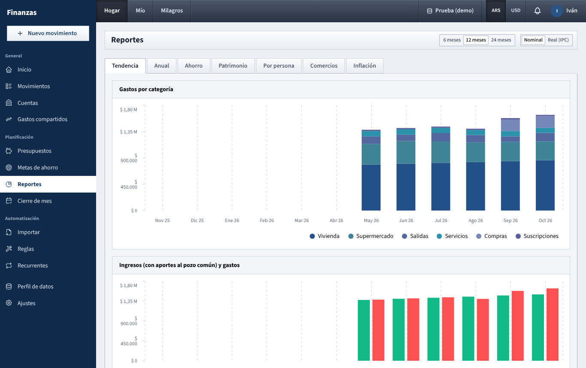

# Reportes

Reportes shows how your money moved over several months: spending per category, yearly totals, savings, net worth, each person's share, where you spend most, and spending against inflation.

## What you see

### Header

- Under the **Reportes** title: the dashboard name and the display currency. In USD it adds "(al dólar BNA del día de cada movimiento)".
- On the right, two controls that appear only on the tabs where they apply:
  - **6 meses / 12 meses / 24 meses**: the period, always ending with the current month. Used by **Tendencia**, **Ahorro**, **Patrimonio** and **Comercios**. Default: 12 months.
  - **Nominal / Real (IPC)**: amounts as recorded, or restated in today's pesos. Used by **Tendencia**, **Anual** and **Ahorro**. Disabled in USD.

All tabs follow the dashboard (**Hogar**, **Mío**, partner) and currency chosen in the top bar, except **Por persona** (always both of you) and **Inflación** (always in pesos).

If some movements could not be converted for lack of a dollar quote, a yellow alert appears at the top of **Tendencia**, **Anual** and **Ahorro**; those amounts count as zero until you load the quotes in **Ajustes**.

### Tendencia

1. **Gastos por categoría**: stacked bars, one per month, split by top-level category. Categories keep the same order (largest over the period first) and color. With more than eight categories, the seven largest are shown and the rest are grouped as **Otros**.
2. **Ingresos y gastos**: income (green) and spending (red) side by side per month. On **Hogar**, when there were transfers into the joint account, the title becomes **Ingresos (con aportes al pozo común) y gastos** and the green bar includes them.
3. **Detalle por mes (últimos 6)**: a table of the last six months of the period. One row per category with the amount and an arrow with the change vs the previous month (red when spending went up), then **Total gastos**, **Ingresos** (income only) and, if there were any, **Aportes al pozo común** (Hogar) or **Aportes al hogar** (Mío, shown as a negative amount).

### Anual

- A year selector (the current year and the five before).
- Four figures: **Ingresos** (or **Ingresos y aportes**; hover it to see the contributions), **Gastos**, **Ahorro** and **Tasa de ahorro** for the whole year.
- **Gastos por mes y categoría**: a table with one row per category and one column per month, plus **Total**. The stronger the blue shading, the bigger the amount. The last rows are **Total** (spending per month) and **Ingresos** (income plus contributions into the pot).

This tab ignores the period control; it always covers January to December of the chosen year.

### Ahorro

- **Tasa de ahorro promedio**: total savings ÷ total income over the period.
- **Ahorro acumulado**: savings added up over the period.
- **Mejor mes**: the month with the highest savings rate, and that rate.
- **Tasa de ahorro por mes**: one bar per month, red when negative. Months without income show 0%.
- **Ahorro neto por mes (ingresos − gastos)**: savings per month in money, red when you spent more than came in. Contributions count as income here, as everywhere.

If there is no income in the period you'll see **Registrá ingresos para ver tu tasa de ahorro.**

### Patrimonio

- **Patrimonio actual**: the sum of all included account balances today, with the change since the first month of the period.
- **Activos**: the sum of accounts with a positive balance.
- **Deudas (tarjetas, saldos negativos)**: the sum of accounts with a negative balance.
- **Evolución del patrimonio**: net worth at the end of each month.
- **Por tipo de cuenta**: stacked bars per account type (bank, savings, investments, wallets, cash, credit cards). Card debt appears below zero.
- **Activos y deudas**: two lines, assets and debts, over time.

Which accounts are included: on **Hogar**, every account you can see (joint, yours, and your partner's non-private ones); on **Mío**, only yours; on a partner's dashboard, their accounts you can see. Archived accounts are still counted. The **Nominal / Real (IPC)** switch does not apply here.

### Por persona

- Its own **Desde … hasta …** month pickers (default: the current month only). It ignores the period control and the dashboard selector.
- One card per person with:
  - **Ingresos**: income in their own accounts plus their share of shared income.
  - **Gastos personales**: expenses from their own accounts that are not shared.
  - **Su parte de lo compartido**: their share of every shared expense, whoever paid.
  - **Pagó de lo compartido**: the full amount of shared expenses they paid from a personal account. Shared expenses paid from the joint account count for nobody here.
  - **Gasto total**: personal spending plus their share of shared spending.
- If your partner keeps their dashboard private, their **Ingresos**, **Gastos personales** and **Gasto total** show **Privado**; only the shared-expense figures are visible.
- **Gastos compartidos: parte de cada uno vs. lo que pagó**: for each person, two bars (**Su parte** and **Pagó**). When one person's **Pagó** bar is higher than their **Su parte**, the other owes them the difference for that period (before any settle-up).

### Comercios

- **Top 10 comercios**: horizontal bars with the total spent at the ten biggest places in the period.
- A table of the top 20 with **Comercio / descripción**, **Categoría** (the category where most of that spending went), **Veces** (number of expenses), **Promedio** (average per expense), **Total** and **% del total** (a bar showing its share among the listed places).

A "place" is the movement's merchant, or its description when there is no merchant. Names are grouped ignoring upper/lower case and extra spaces, so "JUMBO" and "Jumbo" are one place. Only expenses count.

### Inflación

- Its own month picker (default: last month). Amounts are always in pesos (**Montos en pesos.**), whatever the currency toggle says; USD expenses are converted to pesos at their day's quote.
- If no CPI has been loaded yet: **Faltan los datos de inflación**, with a link to **Ajustes**.
- If INDEC has not published the month's CPI yet, a yellow note says the latest available figure is used.
- Four figures:
  - **IPC de** (month): the official monthly inflation.
  - **Inflación interanual**: accumulated inflation from the same month last year.
  - **Tu gasto vs mes anterior**: nominal change of total spending, with **Real:** underneath.
  - **Tu gasto vs hace un año**: the same against the same month a year earlier.
- **Cómo leerlo**: a short reminder. A positive real change (red) means spending grew faster than prices; negative (green) means it grew less.
- **Por categoría**: per category, this month, then **Mes anterior** with **Nominal** and **Real** change, then **Hace un año** with **Nominal** and **Real** change, and a **Total** row. **sin dato** means there was no spending in that category a year ago.
- **Inflación mensual (IPC) de los últimos 12 meses**: bars of the published monthly CPI.

## What you can do

- **See a longer or shorter history**: pick **6 meses**, **12 meses** or **24 meses**.
- **Compare months without inflation noise**: in ARS, switch to **Real (IPC)** on **Tendencia**, **Anual** or **Ahorro**.
- **Review a past year**: open **Anual** and choose the year.
- **Check who carried the shared expenses**: open **Por persona** and set the months with **Desde** and **hasta**.
- **Find what to cut**: open **Comercios** to see where most money goes and how often.
- **See which categories beat inflation**: open **Inflación**, pick the month and look at the red **Real** values.
- **See everything in dollars**: switch to **USD** in the top bar.

## How the numbers are worked out

- **Which movements count**: confirmed movements only, filtered by the dashboard the same way as on [Inicio](inicio.md): on **Hogar**, joint accounts plus shared expenses at full amount; on **Mío**, your accounts with shared expenses at your share. Transfers are never spending. Anything you are not allowed to see (your partner's private accounts and private movements) is left out of every report.
- **Contributions**: transfers from a personal account into a joint account count as money coming in for **Hogar** and going out for that person's **Mío**. Withdrawals from the joint account work the other way.
- **Savings** = income + contributions − spending. **Savings rate** = savings ÷ (income + contributions into the pot).
- **Categories**: subcategories are added into their top-level category. Expenses without a category appear as **Sin categoría**.
- **USD**: each movement is converted at the BNA quote of its own day (sell, buy or average, as set in **Ajustes → Hogar**). Days without a quote use the previous one. **Patrimonio** is different: each month's balances are converted at the quote of that month's last day (today for the current month).
- **Real (IPC)**: each peso amount is multiplied by the price level of the latest CPI month divided by the price level of the movement's month, so older pesos are restated in today's pesos. Months after the last published CPI are not adjusted.
- **Real change** (on **Inflación**) = (1 + nominal change) ÷ (1 + CPI over the same period) − 1. When the month's CPI is not published yet, it is projected with the latest monthly rate.
- **Ahorro** tab: **Tasa de ahorro promedio** and **Ahorro acumulado** only add up months that had income or contributions; a month with spending but nothing coming in is left out of both.

More detail on conversion, CPI and scopes: [How the numbers are worked out](como-se-calcula.md).

## Tips

- Months with no movements show as empty bars, so the period can start with blank months (as in the demo data).
- **Tendencia**'s table shows the **Ingresos** row without contributions, while the chart above includes them. On **Hogar**, look at the **Aportes al pozo común** row for the rest.
- **Patrimonio** on **Hogar** includes personal accounts too; use **Mío** to see only yours.

See also: [Guide index](README.md) · [Inicio](inicio.md) · [Cierre de mes](cierre-de-mes.md) · [Gastos compartidos](gastos-compartidos.md) · [Cuentas](cuentas.md) · [Login and top bar](barra-superior.md) · [How the numbers are worked out](como-se-calcula.md)
