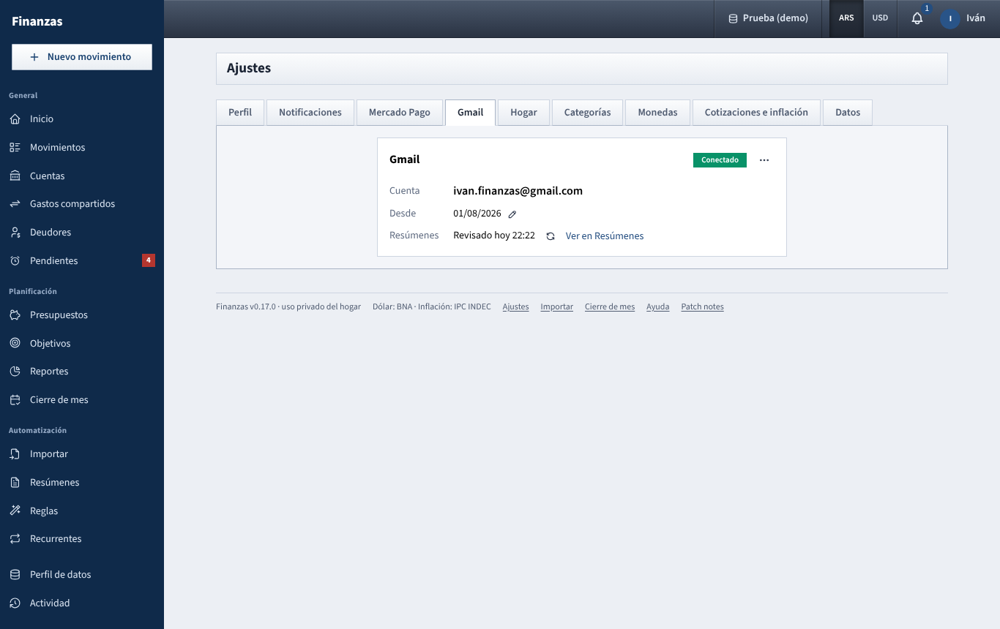
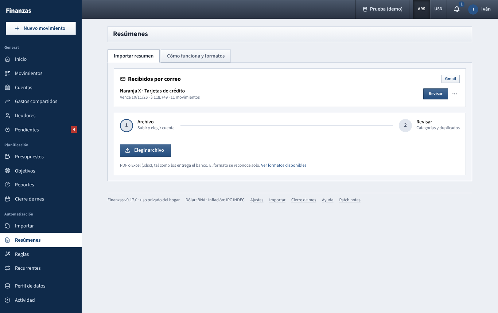

# Get statements by email

Some banks and cards email you the monthly statement as a PDF. Connect your Gmail once in **Ajustes → Gmail** and the app looks for those emails by itself, reads the PDF with the same readers as [Resúmenes](resumenes.md), and leaves each statement waiting in **Resúmenes → Recibidos por correo**. You open it, check it and import it in the usual review. Nothing is imported without that review.

Today this covers **Naranja X** (one email a month, `ResumenDeCuenta_<due date>.pdf`, for every card of the account: physical and virtual).



## What the app can and can't do

- It asks Google for **read-only** access to your Gmail (`gmail.readonly`). It can't send, delete, move or label emails.
- It only searches for the emails of the formats it knows (for Naranja X: from `naranjax.com`, with a PDF attached) and only downloads their PDFs.
- Google gives the app a long-lived permission. It's stored **encrypted**, like a Mercado Pago token, and never shown again or sent to the browser.
- Your connection and your statements are yours: your partner can't see them or tell whether you connected one.
- The PDF of each recognised statement is kept in the data profile until you discard it, so it can be opened again. An email that isn't a statement is remembered without its contents, so it isn't downloaded again.
- **Desconectar** removes the permission from the app and asks Google to cancel it. You can also cancel it yourself in your Google account: **Security → Your connections to third-party apps**.

## Set up Google access (once, whoever runs the app)

Google only lets an app read Gmail through an "OAuth client" created in a Google Cloud project. It's free and takes about 15 minutes on a computer. You do it once for the household; each person then connects their own Gmail.

1. Go to **console.cloud.google.com** and create a project (for example *Finanzas*).
2. **APIs & Services → Library**: search for **Gmail API** and click **Enable**.
3. **Google Auth Platform** (called **OAuth consent screen** in older consoles):
   - **Branding**: app name *Finanzas*, your email as support and developer contact.
   - **Audience**: user type **External**. Click **Publish app** so the status is **In production**. While it stays in **Testing**, Google cancels the permission every 7 days and you would have to connect again each week.
   - **Data access**: add the scope `https://www.googleapis.com/auth/gmail.readonly`.
4. **Clients → Create client**: type **Web application**. Under **Authorized redirect URIs** add the address shown in **Ajustes → Gmail** (it has a copy button), exactly as it appears. For example:
   - `http://localhost:3000/api/me/gmail/callback` on your own computer;
   - `https://finanzas.example.com/api/me/gmail/callback` on a server with `PUBLIC_URL=https://finanzas.example.com`.
5. Copy the **Client ID** and the **Client secret** into the `.env` file (next to `package.json`, or the one Docker uses):

   ```
   GOOGLE_CLIENT_ID=1234567890-abc.apps.googleusercontent.com
   GOOGLE_CLIENT_SECRET=GOCSPX-...
   ```

6. Restart the app. **Ajustes → Gmail** now shows **Conectar Gmail**.

Because the app is your own and isn't reviewed by Google, the consent screen says *Google hasn't verified this app*. Click **Advanced → Go to Finanzas** to continue. This is expected for a personal app.

## Connect your Gmail (each person)

1. Open **Ajustes → Gmail** and click **Conectar Gmail**.
2. Google asks which account to use and whether the app may read your email. Accept. You come back to the same tab with **Conectado** and your address.
3. Pick **Desde**, the oldest date to look from (three months back by default), and click **Buscar resúmenes**. The app searches right away and then every 6 hours, in the data profile you're using.

Turning it on is per data profile: statements only arrive in the profiles where you turned it on. To stop in a profile, use **⋯ → Dejar de buscar en este perfil**.

The round arrow next to **Revisado** searches again right away (once every 30 seconds at most). **Ver en Resúmenes** takes you to what arrived.

## Import a statement that arrived

When a statement arrives, the bell (and your email, if you get alerts) says *Llegó el resumen de Naranja X* with the total and due date.



1. Open **Resúmenes**. **Recibidos por correo** lists what's waiting, with the due date, the total and the number of movements.
2. Click **Revisar**. The statement opens in the wizard below, as if you had uploaded it, and its checks run as usual.
3. The first time, choose the **Cuenta de destino** (for example a credit-card account called *Naranja X*). The next statements of the same card account come with that account already chosen.
4. **Vista previa**, review and **Importar**, exactly as in [Resúmenes](resumenes.md). The statement moves to **Importados**, where **Abrir** opens it again.

If you don't want one (you already loaded it by hand, for example), use **⋯ → Descartar**. Its PDF is deleted; the email stays marked as seen.

A statement marked **No cuadra** was read but its numbers don't add up to its own totals; it can be opened to see which check failed but not imported. One marked **No se pudo leer** looked like a known format but couldn't be read; the app tries again on every search, so it shows up as soon as a newer version reads it. Meanwhile you can download it from the email and see what [Resúmenes](resumenes.md) says.

## Naranja X

- One statement covers **every card** of the account (for example *NX Master*, *NX Visa* and *NX Virtual*). All of them go into the same account in the app, and each movement's note says which card it was: *Tarjeta NX Master*.
- Purchases in one payment show **01** in the statement and get no installment. **01/03** is installment 1 of 3, dated on the statement's close date, with the purchase date in the note, like every card statement.
- Interest, maintenance (*Plan Turbo*), IVA and Sellos are separate rows in **Intereses de tarjeta**, **Comisiones bancarias** and **Impuestos**.
- The payment of the previous statement starts unticked: it's already recorded from the account you paid from.
- Checks: previous balance − payments + purchases + other charges = total to pay; each cardholder's purchases add up to the subtotal printed above them; the total of the detail page matches the first page.
- Dollar purchases stay in dollars and only go into an account in dollars. The statements read so far had no dollar purchases, so if one has them and doesn't print a dollar total, the app warns you to check those amounts by hand.

## If it doesn't work

- **Ajustes → Gmail says Sin configurar.** `GOOGLE_CLIENT_ID` or `GOOGLE_CLIENT_SECRET` is missing, or the app wasn't restarted after adding them.
- **Google shows `redirect_uri_mismatch`.** The address under **Authorized redirect URIs** must be exactly the one in **Ajustes → Gmail**, including `http` or `https`, the port and no trailing slash. If you open the app at a different address (another port, a domain), add that one too, or set `PUBLIC_URL`.
- **It says Volvé a conectar.** Google no longer accepts the permission: it was cancelled, your password changed, or the Cloud project is still in **Testing** (7 days). Publish it (step 3) and use **⋯ → Conectar de nuevo**.
- **Nothing arrives.** Check that the statement email is in this Gmail account, has the PDF attached (not just a link) and arrived after **Desde**. Moving it out of spam helps too.

See also: [Resúmenes](resumenes.md) · [Ajustes](ajustes.md) · [Connect Mercado Pago](mercado-pago.md) · [Guide index](README.md)
