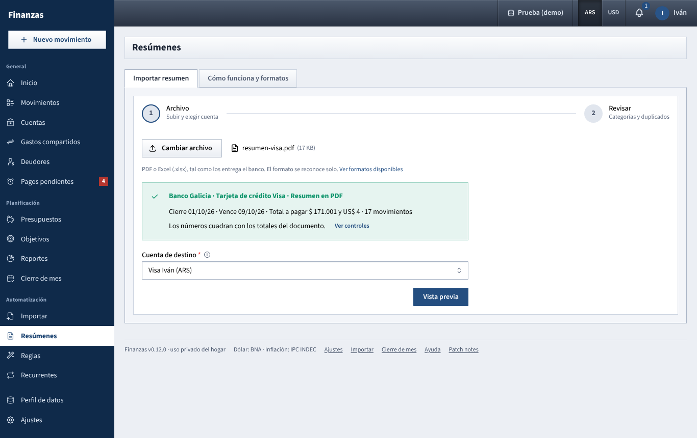

# Resúmenes

Load a bank or card statement exactly as the bank gives it (a PDF or an Excel file) and let the app recognise it, check it and turn it into movements.

## What you see

Two tabs:

- **Importar resumen**: the import wizard, in two steps: **Archivo** (upload, recognition and destination account) and **Revisar** (types, categories and duplicates).
- **Cómo funciona y formatos**: how the import works and the list of statements the app can read today, each with a **Detalles** button.

**Resúmenes** does not need a preset. Where [Importar](importar.md) asks you to say which column is the date and which is the amount, here the app works that out by itself, because it only accepts formats it knows. For anything else, keep using [Importar](importar.md).

## What the app can read today

| Format | File | Currency |
| --- | --- | --- |
| Banco Galicia, **Caja de Ahorro en pesos**: extract | Excel (.xlsx) | ARS |
| Banco Galicia, **Caja de Ahorro en pesos**: monthly statement | PDF | ARS |
| Banco Galicia, **Tarjeta de crédito Visa**: statement | PDF | ARS and USD |
| Banco Galicia, **Tarjeta de crédito American Express**: statement | PDF | ARS and USD |
| **Naranja X**, credit cards: account statement (every card of the account in one) | PDF | ARS and USD |

The list in the app is always the current one; each format's **Detalles** says what it reads, how to get the file, which checks it runs and what to keep in mind. More formats will be added over time (for example Ualá and Binance).

Statements that arrive by email (Naranja X today) can also come by themselves: see [Get statements by email](resumenes-por-correo.md).

A PDF must be the original the bank gives you, with selectable text. A photo or a scan can't be read.

## What you can do

### Import a statement that arrived by email

If you connected Gmail in **Ajustes → Gmail**, a **Recibidos por correo** box appears above the wizard with the statements waiting. **Revisar** opens one in the wizard, already uploaded and with the account it went to last time; from there it's the same two steps as below. Details: [Get statements by email](resumenes-por-correo.md).

### Import a statement

**Step 1: Archivo**

1. Click **Elegir archivo** and pick the PDF or the Excel file. You do not say which bank or product it is.
2. A green box says what was recognised, for example *Banco Galicia · Tarjeta de crédito Visa · Resumen en PDF*, with the closing and due dates, the total to pay and the number of movements. **Ver controles** lists the checks that were run.
3. If the file is not recognised, a red box says so and lists the available formats. If its numbers do not add up, the box says which check failed and the file cannot be imported.
4. Choose the **Cuenta de destino**: the bank account for an extract, or the card's account for a card statement.
5. Click **Vista previa**.

**Step 2: Revisar**

The same review table as [Importar](importar.md), see there for every control. What is specific to statements:

- **Sugerida** next to a category means that it comes from the suggested rules bank (see [Reglas](reglas.md)), not from a rule of yours. Your own rules always come first. If nothing matches, the row stays without a category.
- **Pago de la tarjeta** and **Deuda en dólares** rows start unticked. A card payment is already recorded from the bank account's extract, and importing it here would count it twice. The USD debt line is the bank moving a dollar balance to pesos, not a new expense.
- **Otra moneda** rows start unticked. Dollar purchases of a card statement are only imported into an account in dollars: import the same statement again, choosing the dollar account.
- Transfers between your own accounts and card payments seen from the bank account are proposed as **Transferencia**; choose the other account.
- Installment purchases show **cuota X/Y** in the description and the purchase date in the note; see below for their date.

Click **Importar N movimientos**. The result can be undone from **Importar → Historial**, like any other import.

### See what the app can read

Open **Cómo funciona y formatos**. Click **Detalles** on a format to see what is read, how to get the file, the checks, and the limits.

## How the numbers are worked out

- **Checks.** Before anything is imported, the numbers are checked against the totals the document prints itself. An extract: the balance after each movement must equal the previous balance plus the movement; the PDF also checks the totals of credits, debits and the final balance. A card statement, in pesos and in dollars separately: previous balance + payments + purchases + charges = total to pay, and the purchases must add up to **Total Consumos**. A file that fails is never imported, because a wrong reading would put wrong numbers in your accounts.
- **Dollars stay in dollars.** A dollar purchase is never converted. The exchange rate that some documents print (a dollar sale, the conversion of a USD debt) is kept in the note only.
- **Sign.** Card statements print charges as positive numbers; they are imported as expenses. Credits and refunds become income in the category **Reintegros**.
- **Installments.** A card statement shows each installment with the original purchase date, which can be months old. Installments are dated on the statement's **close date** so they fall in the month they are billed; the purchase date is kept in the note. Other card purchases keep their own date.
- **Interest and taxes of a card** (interest, stamp tax, VAT, withholdings) are separate rows in the categories **Intereses de tarjeta** and **Impuestos**. Salary, bank interest and refunds also get a fixed category.
- **Categories of merchants** come first from your rules, then from the suggested rules bank. Merchants that are in neither stay without category, they are never guessed.
- **Duplicates** use the same check as [Importar](importar.md): importing the same statement twice marks every row as **Duplicado**.

## Tips

- If you have both the Excel extract and the monthly PDF of the same account, import only one of them.
- Import the account extract and the card statements. The payment of the card is recorded from the account, once.
- Create rules for the merchants that stay uncategorised; the next statement comes out categorised. See [Reglas](reglas.md).
- The uploaded file is kept in memory for 30 minutes and is not stored. After that you see *El archivo expiró. Volvé a subirlo.* Statements that arrived by email are kept until you discard them.
- A Naranja X statement covers every card of the account; the card of each purchase is in its note (*Tarjeta NX Master*).
- The marks (`*`, `K`, `F`) that Galicia prints next to some card purchases are not interpreted.

See also: [Guide index](README.md) · [Get statements by email](resumenes-por-correo.md) · [Importar](importar.md) · [Reglas](reglas.md) · [Cuentas](cuentas.md) · [Movimientos](movimientos.md)
